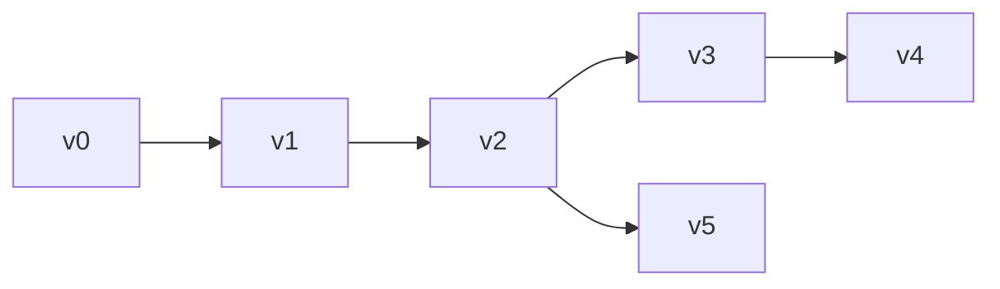

# Gve.Text

This is the core library for GVE.

## Chain

The core component here is `Chain<T>`, designed to represent multiple linear combinations of a set of entities. We represent these entities as nodes of a graph, connecting them into linear sequences via links. So, the chain has:

- a set of nodes.
- a set of tagged links. Links get a tag (conventionally with form `vN` where `N` is a number) representing a specific version of the sequence of nodes represented by all the links with the same tag.

Nodes and links can only be added. Once added, they stay there forever. Client code can ask the chain to produce the sequence of nodes corresponding to any of the links tags, and the chain will return that sequence using only the nodes effectively linked in a linear sequence by the links with the specified version tag.

⚙️ In technical terms, we could describe this structure as a tagged multigraph linked list:

- it's a linked list because each node has at most one child in each version of the list.
- it's a multigraph because it allows multiple edges (links) between nodes.
- it's tagged because each version of the list (each set of links) has a unique tag.

When the chain is empty, there are no nodes or links. When there is at least one node, there always are links for the head and the tail of the chain. So, the structure, when not empty, always alternates links and nodes, starting and ending with links. For instance, a sequence of nodes corresponding to characters `A` and `B` for version `v0` (=the first version) would be encoded by these links:

1. null -> A
2. A -> B
3. B -> null

In GVE, the chain entities are _characters_, and their linear combinations build a sequence representing a _text_. So, a chain can represent multiple versions of a text at the same time, and we use instances of `ChainNode<char>`.

## Nodes

Nodes are of type `ChainNode<T>` where `T` is the node data payload type. In GVE, `T` is always `char`. Main properties:

- `Id`: each node in a chain gets a unique ID, which is a progressively increased number managed by the chain itself. So, when a text is first set on the chain, its characters IDs correspond to their ordinal numbers in the text: the first character has ID=1, the second has ID=2, etc. Later, when an operation adds new text, and thus new nodes, they get the next available ID.
- `Label`: the label of the node. This might be different from its character value, which is found in `Data`, e.g. to represent non-printable characters like whitespaces.
- `Data`: the data payload of the node, in GVE corresponding to `char`.
- `SourceTag`: the tag of the version which added this node to the chain.

## Links

Links are of type `ChainLink<T>` where `T` is the node payload data type (same as `T` of `ChainNode<T>`) it links. In GVE, `T` is always `char`. Main properties:

- `Tag`: link's version tag.
- `Source`, `Target`: the source and target nodes which get linked.

## Operations

Any modification to the chain is done via operations which add:

- links (which connect or disconnect or reorder nodes) for the new version produced by their output;
- possibly new nodes if they add them (in the case of add/replace operations).

While `Chain<T>` provides a low-level API for editing its nodes and links, operations add a higher-level layer which leverage chain's logic in a more human-friendly way.

### Operation Features

Operations have an open set of generic metadata represented by _features_. Operations inject these features into their output: either in the chain as a whole, or in specific nodes.

Operation features are of type `OperationFeature`, which extends the basic name=value pair of `Feature` with some additional metadata about the operation behavior:

- `IsNegated`: negates a feature, meaning that the operation should remove it if present.
- `IsGlobal`: true if the feature refers to the chain rather than to specific nodes.
- `IsShortLived`: true if the feature is injected but it will be removed when the next operation is executed.
- `IsTraceFeature`: true if this feature belongs to the category of trace features, which are used to trace the execution of operations.

### Operation Tags

Operations have an _input tag_ and an _output tag_. The input tag tells which is the version they are editing (as specified by the links having that tag); the output tag tells which is the tag assigned to the new links generated by it. While the input tag can be set in a non-linear way (to represent branching edits), the output tag is always calculated. It is just `v` + the next available ordinal number in a progression.

So, the initial text set in the chain belongs to tag `v0`. The next tag is `v1`, then `v2`, etc. If at some point we add another operation branching from `v1`, its output tag would not be `v2`, which has already been used by the first branch; but it will just be the next available ordinal. For instance:

### Operation Metadata

Every operation has some essential metadata (`OperationMetadata`):

- `Id`: a unique ID.
- `Type`: the operation's type.
- `Rank`: a number representing the probability rank in the reconstruction of this operation (0=N/A, 1=high, 2=lower, etc.).
- `GroupId`: optional string to virtually group multiple operations sharing it.
- `Features`: the features to be injected by this operation into its output.
- `Sources`: any number of sources for the operation.

Operations working on `char` derive from `CharChainOperation` (which in turn derives from `OperationMetadata`), which contains shared logic and data:

- the coordinates of the text it affects: the first affected character in `At` (the ID or index of the character; `AtAsIndex` is true when `At` is an index rather than an ID) and `Run` (the run of characters starting from `At`, 0-N according to the operation type; e.g. a delete operation with `Run`=2 deletes the character in `At` and the one following it, while an insert operation has `Run`=0 because `At` there is used only as an anchor for the addition position).
- the text `Value` when required (e.g. a replace/add operation's value is the new text).
- `NoTraceFeatures`: true when you do not want to add trace features.

Operations derived from this base may add more properties and they are:

- replace
- delete
- add-before
- add-after
- move-before
- move-after
- swap
- annotate: this operation does not change the text but only affects features.

### Operation Context

Operations work on a shared data context, represented by `ChainOperationContext<T>` (`T` is the same as `T` of `ChainNode<T>`). This context contains:

- `Chain`: the underlying chain.
- `LastTag`: the tag for the output of the last executed operation.
- `Steps`: the steps executed on the chain, each (`ChainOperationContextStep`) consisting of an operation and its input and output tags. Whenever an operation executes, a step is generated. A step has:
  - `Operation`: the metadata of the operation which generated it.
  - `InputTag`, `OutputTag`.
  - `Result`: a string summarizing the result (=the sequence of characters generated by the operation).
  - `FeatureSet`: the set of features emitted up to this step, both for specific nodes and for the chain as a whole.
  - `RefNodeIds`: the ID of nodes in the chain that are involved in the operation which generates this step. For instance, a delete operation would have the deleted node ID(s) as its reference.

In turn `ChainOperationContext<T>` derives from `ChainOperationContextFeats` which contains the features belonging to specific nodes or to the chain as a whole:

- `Features` is the list of global features.
- `NodeFeatures` are node-specific features; this is a dictionary whose key is a string built with version tag + `_` + node ID, and whose value is the list of that node's features in that specific version.

## DTO

The DTO folder contains DTO objects used to store data about a chain:

- `CharChainNode` represents a node with its essential metadata.
- `CharChainOperationSource` has source data (metadata, features, etc.) for building an operation instance.
- `Snapshot` contains all data required for the chain, i.e. the "base text" (the `v0` text, as a list of `CharChainNode`'s) and the sources for building all the operations transforming it.

## 🐛 Design Issues

I notice these design issues:

- storing features in steps is not efficient:
  - it is redundant.
  - it makes it difficult to fetch the features of a specific node.
  - it generates a huge output in the API layer because it returns the full set of features for each step.

I would rather suggest to store features in a different way:

- node-specific features in the nodes themselves. A node once added stays in the chain forever, so its instance can accumulate all the features for it. We cannot just use a list, because features can be added, removed, or modified after each operation. So we use a dictionary of lists of features, keyed by version tag. This still duplicates features inherited from previous operations at each version, and this is ok because we want different instances so that values are preserved from operation to operation; but it's much more compact than multiplying this duplication for each step.
- global features in the chain itself. Here too we would have a dictionary keyed by version.

This implies:

- removing `ChainOperationContextStep.FeatureSet`.
- adding `FeatureSet` as a class wrapping a `Dictionary<string, List<OperationFeature>>` to both `ChainNode<T>` and `Chain<T>`. This class can also centralize logic related to adding/removing features.
