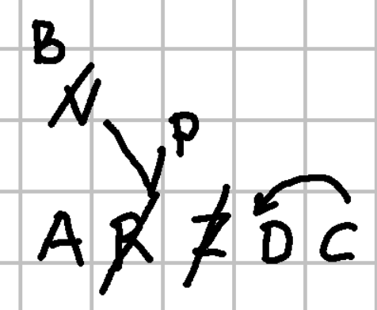
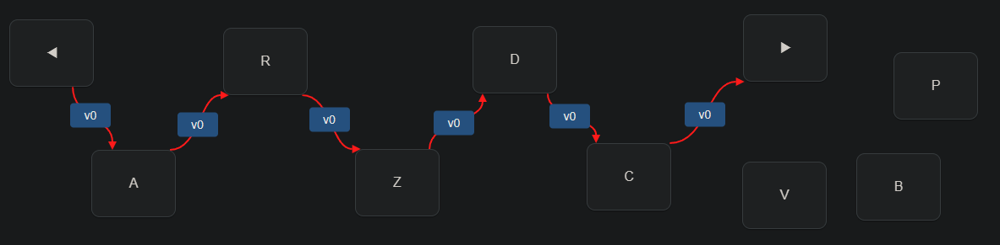
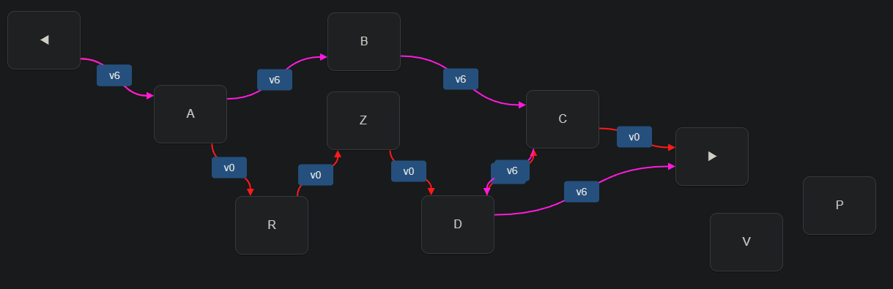
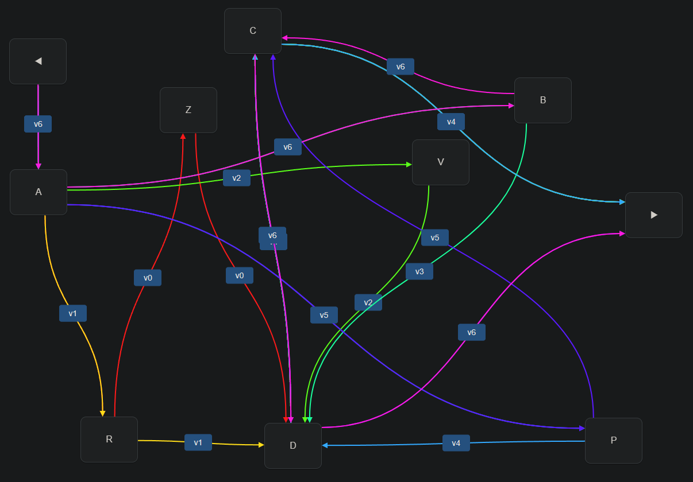

# Modeling an Autograph

## Basic Terminology

Let us first use our case study (GVE) to define some terms we use in the technical documentation with a specific algorithmic meaning.

In the case of GVE, the essential source of epigrams is represented by autograph sheets from handbooks. Whatever its physical support(s), here we call an autograph 🔖 **sheet** for short.

The main challenge in modeling sheets is that they do not just represent a linear text; rather, they represent a sort of 🔖 **snapshot** of the creative process which in the author's mind would have led to the intended text.

This is because graphically the snapshot does not just represents a text, but includes many corrections, rethinkings, or refactorings of it, in the form of various types of 🔖 **annotations** (deletions, insertions, transpositions, side notes, etc.).

The snapshot is thus a sort of picture taken from the author's mind in relation to the text being composed at a given point in time. This does not necessarily imply that this is the end stage of the creative process underlying the text. The process may well have gone further on; but this is not reflected by the snapshot, which just represents a picture which froze an instant of this process at a given time.

The snapshot is thus far from being the carrier of an undisputed linear text; it's an even chaotic bunch of text and annotations on a sheet. It is up to the reader to make sense of these annotations, and try to deduce one or more versions of the text from his interpretation.

The annotations represent changes on the text; but there often is no way to know their relative order, or even their selection when they represent several competing versions of the text. _It is like having all the ingredients_ (our text with annotations), _when we have lost the recipe_ (how to select and order the annotations to generate the intended version(s)).

When for whatever reason an authoritative version of the final outcome of all these operations on the text is lacking, in a traditional (paper) edition usually we are forced to forge one, representing the best effort in interpreting our sheet. Of course, that would just be a best effort; and it might even be the case that we are not sure in deciding among competing interpretations. In the end, we come up with our best recipe.

In a digital edition instead, we have the power to handle all the rich and complex data preserved by our snapshot, without resorting to compromises. We can represent all the ingredients (text and annotations), all the recipes (annotation selection and ordering), and all their outcomes (resulting versions), while still keeping each as a separate layer, so that everyone can evaluate our text reconstruction, and even provide their own alternatives.

Of course, this requires a proper model.

## Model Requirements

Ideally, the main requirements of this model are:

1. we want to **represent the snapshot** itself in a _computable_ model.
2. we want to **preserve** as distinct, structured data our _ingredients_ (text and annotations), _recipes_ (annotation selection and ordering) and _outcomes_ (text versions).
3. we want to represent the snapshot annotations both on their **textual and visual form**. This is because the graphical representation of each annotation is a semantic information, which should be encoded next to the textual variant it represents. By preserving both these layers of data we provide a richer model, which can be inspected by scholars used our digital edition as a tool, or just leveraged by more casual users as another way of looking at the text and its creation process.

A good model should meet all these requirements using the simplest possible structure, which implies _raising the abstraction level_ so that even the finest details can find a generalized and consistent representation.

This also allows our model to lay the foundation of a paradigmatic approach, leading from a single case study to a reusable tool.

## Core Chain Model

Our model core is represented by a general purpose data structure we call 🔖 **chain**. The task of this data structure is _representing multiple linear combinations of a set of entities_. We represent these entities as **nodes** of a **graph**, connecting them into linear sequences.

In our specific case, our entities are characters, and their linear combinations build a sequence representing a text. So, a chain has the power of representing multiple texts (i.e. multiple versions of what we regard as the "same" text in the course of its composition) at the same time; and this is right what a snapshot on a sheet does.

### Operations

Let us see how this works by using a simplified diagram. Consider this sheet, which I created by first writing characters `ARZDC`, and then making some annotations on it, representing variations of the text.

A text being a linear sequence of characters, we don't care creating a true text in a specific language here; we just deal with such sequences, so that our examples are shorter and more to the point.



As you can see, our snapshot provides annotations which can be interpreted as operations changing the **base text**, which is just what happens to be the starting point of our digital representation. So, "base text" here has no genetic or philological implication; it is just a practical device in our model. As our model represents multiple versions of what we consider the same text, this means that it represents a set of changes on it, from the first to the last version in the author's mind. Again, "first" and "last" here don't imply that these are the two edges of the line representing the whole creation process; rather, they are the two edges of the segment in this line which is covered by our snapshot.

When representing multiple versions of a linear sequence in terms of changes of a starting sequence, of course we need right that: _a sequence to start with_. This is our "base text".

Often, this base text will correspond to what in a relatively tidy snapshot looks like a line in the main flow of text, used as the anchor for annotations. In our diagram, this is the line where I wrote `ARZDC`.

This does not necessarily imply that I _first_ wrote `ARZDC`, and _then_ all the rest; I might well have written `AR`, then some of the annotations above it, and then the rest of the letters in the same line (`ZDC`); or I might have followed any of the other order of actions I could ever imagine for writing the text photographed by our snapshot. This is not relevant here; all what we want is a sequence to start with, and on the ground of both visual and textual representations (and optionally their meaning, when dealing with a real text) I happen to pick `ARZDC`.

Having defined our base text, let us now focus on the annotations. The annotations on our snapshot clearly represent _operations_ on the text, which in a visual way lead to generate different versions of it:

- the slash on `Z` represents a _deletion operation_.
- the slash on `R` is part of a _replacement operation_. Of course, in simpler terms a replacement is just a composite operation, made of a deletion followed by an insertion. Yet, from our more synthetic point of view we prefer to look at it as a replacement. In fact, that's what our snapshot visuals aim to represent; we have a slash on `R`, and two segments originating from it and leading to two alternative letters: `V` on the left, and `P` on the right.
- in turn, the slash on `V` is another _replacement operation_: here it gets replaced by `B`. Note that in this case we are nesting an operation on top of another operation; which, in turn, happens to be on a branch representing two alternative operations. One branch stems from `R` and goes across `V` up to `E`; the other one stems from `R` and goes up to `P`. It is our conventional interpretation of these visuals which defines these operations, and in some cases even hints at their relative order.
- finally, the arrow on top of `DC` represents a _movement operation_: `C` is moved before `D`. Again, this is a higher-order, complex operation that we could just represent as a deletion (delete `C`) and an insertion (insert `C` before D); but we prefer a complex operation here, as it best fits what we clearly understand about the writer's intention when seeing the arrow "moving" `C` before `D`.

So, all of our _annotations can be modeled in terms of operations_, which affect our chain.

Also, we do not just limit ourselves to basic operations like insertion or deletion. Even if these would be all what is strictly required to represent any change on a linear sequence, we want a model as near as possible to a human-friendly representation and interpretation of our snapshot.

This is because operations here essentially belong to the layer of interpretation, and interpretation here is a human fact. Here, we are looking at our _snapshot_, and inferring operations from its visuals. The _snapshot is objective, empirical evidence_: we effectively take a photographical image of it, and we could even geometrically represents all its visuals.

Conversely, _operations are our interpretation of these visuals_, which define the ingredients of our lost recipe: the letters of our text, and the operations which change their combinations into sequences.

We thus want such operations to be as close as possible to a human-friendly way of thinking; and for this reason we allow for many complex, higher-order operations, as far as they best fit our needs.

### Chain

So far we have modeled our snapshot and its ingredients: we have letters, and operations on them. Some of these operations just move letters around; others can delete them, or add new ones.

Our next challenge is representing a recipe. In our sample snapshot, our ingredients are:

- the base text `ARZDC`;
- the deletion of `Z`;
- the replacement `R=V`;
- the replacement `V=B`;
- the replacement `R=P`;
- the movement of `C` before `D`.

As we have seen, these operations already imply a degree of interpretation; but in most cases this is a trivial interpretation, which poses no issues.

The main issue for interpretation is instead _selecting and ordering our ingredients_, that is, building a **recipe** for handling them in a way leading to a final outcome, which in our case is a version of our base text.

In other terms, we have six ingredients listed. Among them, five are operations. Now, should I select all of them to build a specific version, or just a subset? And what would be their order of application? We need at least one recipe, or even more than one; each of them will represent an interpretation of our snapshot leading to a specific **version** of our text.

So, recipes are completely up to our interpretation: of course, they are constrained by the number and type of available ingredients; but within these limits, any combination is possible. It is up to scholar's judgement to consider all the complex factors behind a recipe, and define it, thus generating one or more versions of a text.

Notice that our model will always include all the ingredients, as we want to fully represent our data at the snapshot level. We do not want any of our interpretations have destructive effects on our data: just like the snapshot presents all the ingredients mixed together, we want to collect and preserve all of them as distinct entities. This will not only ensure that our model fully represents our data; but also that we can add as many interpretations as we want on top of them, or even allow others use the same data to come out with their own interpretations.

So, the challenge here is having a model which allows scholars to define a recipe for combining ingredients to get any number of distinct text versions, while still containing all the ingredients in the same box. In a sense, if you think of a text as a string (a linear sequence of) characters, it is like getting a _time-enabled string_, i.e. a single data structure with the ability of representing not just a single sequence, but many different ones, all within the same box. Now, this is right what the _chain_ data structure is for.

This data structure consists of a _linear sequence_ of **nodes**, each connected to the previous and the next node by a **link**. In our case, nodes are characters.

So, a chain has a set of nodes, and a set of links connecting them. Notice that none of these sets is ordered; it is the link which defines the order of a node in a sequence.

To allow for multiple sequences in the same set, each link has a _version tag_, which adds the dimension of time to this structure. So, essentially any change on the texts represented by the chain is made by adding new layers of links, where each layer is just defined by the link's tag.

For instance, let us start from our base text, `ARZDC`: if we represent nodes inside square brackets, and links with the two characters they connect separated by a colon, the base text (let's call it `v0`) is:

```txt
-:A [A] A:R [R] R:Z [Z] Z:D [D] D:C [C] C:-
```

This means that our chain contains 5 nodes (`A`, `R`, `Z`, `D`, `C`) and 6 links:

- `-:A`, i.e. the link connecting the start edge of the chain to the first node;
- `A:R`, link between `A` and `R`;
- `R:Z`, link between `R` and `Z`;
- `Z:D`, link between `Z` and `D`;
- `D:C`, link between `D` and `C`;
- `C:-`, i.e. the link connecting the end edge of the chain to the last node.

All these links are tagged with version `v0`. Once we have filled the chain's sets, we can generate any of the text versions by just following all the links tagged for that version, starting from the first link and moving from node to node.

For instance, to get the text for version `v0` we start from link `-:A`, which leads us to node `A`; then, we get to link `A:R`, which leads us to node `R`; and so forth, until the end link (`C:-`). As we move from node to node, we collect characters; in the end, the collected characters represent our sequence, `ARZDC`.

If now we want to represent another version of the text, as resulting from the deletion of `Z`, all what we have to do is adding a new set of links for the next version (let's call it `v1`):

- `-:A`, i.e. the link connecting the start edge of the chain to the first node;
- `A:R`, link between `A` and `R`;
- `R:D`, link between `R` and `D`. This bypasses `Z`, with the effect of "deleting" it from the text;
- `D:C`, link between `D` and `C`;
- `C:-`, i.e. the link connecting the end edge of the chain to the last node.

The nodes set is unchanged; `Z` itself is still there. Yet, we have bypassed `Z` in the sequence by short-circuiting the link between `R` and `D`. The result is that when building our version text, we no more traverse the `Z` node, so that we get `ARDC`.

Other operation types, like additions or replacements, also imply the addition of nodes; but for the rest they work the same, by adding new links in the set. For instance, if we are going to replace `R` with `V`, we will:

- add a new node, `V`.
- add a new set of links for a new version (tagged `v2`):
  - `-:A`
  - `A:V`
  - `V:D`
  - `D:C`
  - `C:-`

Again, we just added items to our chain's sets, but the result is that we have defined another sequence for it, corresponding to yet another text version: `AVDC`.

A demo UI for this data structure can let you play with operations on it, showing among other data also a diagram representing nodes and links in the chain. So, let us consider the full set of operations in our sample snapshot, and build the corresponding diagrams. Our base text is `ARZDC`, representing our version 0 (`v0`); operations are:

- the deletion of `Z`;
- the replacement `R=V`;
- the replacement `V=B`;
- the replacement `R=P`;
- the movement of `C` before `D`.

The diagram below shows the representation of version `v0` via nodes and links once all the operations have been executed, in the order specified above:



For clarity purposes, the diagram also shows start and end edges as nodes (with left and right triangles); yet, in the set there are no such nodes, but only nodes for letters `A`, `R`, `Z`, `D`, `C`, `V`, `B`, `P`. Note that some of the nodes are left out from the sequence; they still belong to the nodes set, but they happen not to be used for building the text of `v0`. This is because they were effectively added later, by replacements. So, following links you get `v0` text `ARZDC`.

Let us now consider the last version produced after all the operations have been executed; this is version 6 (`v6`). To avoid overcrowding the diagram, here we have filtered out links not belonging to `v0` or `v6`:



>Note that when showing more than one versions some links can be overlapped in the diagram, according to how you move the shapes around. The UI diagram is interactive, so you are free to drag shapes wherever you want, maybe revealing or hiding some of them. In this case I have moved nodes to make easier to read the different versions; yet, some links are overlapped: this is the case of `-:A` for both `v0` and `v6`: `v6` overlaps it completely, but it's still there (just compare the previous diagram showing just `v0`).

Now you should start to see the chain's ability to represent multiple versions at the same time. Here we have two sub-sets of links: those tagged with `v0` (red), and those tagged with `v6` (magenta).

If we follow `v1` links, we traverse these nodes:

1. `A`
2. `R`
3. `Z`
4. `D`
5. `C`

If instead we follow `v6` links, we traverse these nodes:

1. `A`
2. `B`
3. `C`
4. `D`

While the nodes set stays the same, our _links define the recipe: they tell which nodes to pick from the set, and in which order_.

Thus, we have gained the ability of representing multiple strings with this sort of time-enabled strings: in a sense, the chain is a multi-versioned string.

If we remove filters from the diagram, and look at all the versions from `v0` to `v6` at once, here is the result:



The links now define 7 different versions of our text:

0. v0: `ARZDC`
1. v1: `ARDC`
2. v2: `AVDC`
3. v3: `ABDC`
4. v4: `APDC`
5. v5: `APCD`
6. v6: `ABCD`

So, a single chain structure represents 7 variants of the same text; these are 7 recipes, all using the same ingredients, which are always preserved in the box, whatever recipe we decide to follow.

Whenever we apply an operation to our chain, we get a new version out; so we have the fully detailed text generation process, step by step, as defined by our interpretation. Of course, _not all of the versions output by this detailed process are eligible for representing what we really want to define as a text "version"_; maybe in our interpretation we have isolated 3 versions, corresponding to `v2` (`AVDC`), `v5` (`APCD`), and `v6` (`ABCD`), while discarding the other as just generative steps between them. The chain has a mechanism for this selection, but we must first introduce another feature of them before delving into its details.

To sum up, we have thus met the [first two requirements](#model-requirements) of our model:

1. represent the _snapshot_ itself in a _computable_ model.
2. preserve as distinct, structured data our _ingredients_ (text and annotations), _recipes_ (annotation selection and ordering) and _outcomes_ (text versions).

Yet, we still have to address the last one:

3. represent the snapshot annotations both on their _textual_ and _visual_ form.

This implies delving into more details about our chain's operations.

### Metadata and Visuals

As we have seen, the chain structure is a container of any number of versions of a text, and operations target it by adding new links and optionally new nodes to its set.

We have also remarked that operations being the first act of interpretation of our snapshot, we do not limit ourselves to the basic ones only (insertion and deletion), but rather we prefer a full set of higher order operations, which best fit the nuances of our descriptive model.

So, chain operations are abstractions on top of the chain structure, used to represent higher level editing operations on the chain's text. There are 8 types of operations (listed with their corresponding operator in their text-based representation):

- replace (`=`)
- delete (`-`)
- add before (`+[`)
- add after (`+]`)
- move before (`>[`)
- move after (`>]`)
- swap (`<>`)
- annotate (`:`)

Even though GVE will provide a UI to edit such operations, it also provides a text-based representation for them. The general text-based syntax for these operations includes these components, from left to right:

(1) `(ITAG:OTAG)`: these are the optional input and/or output **version tags**. They represent the input and the output versions in the chain before and after applying the operation. You can specify none, just one, or both. Usually there is no need to specify version tags, as the system can generate tags, and automatically increase their number (`v0`, `v1`, `v2`...) after each operation is applied. You might want to specify a version when you want to use a special name for it (which anyway is discouraged, as it would introduce variants in the expected naming scheme for tags), or when you want to start from a version which does not correspond to the latest generated version.

(2) `ATxRUN` or `@ATxRUN` (where `AT` is required): the **range** of characters to select as the input of the operation. `AT` is either a _node ID_ or index (when prefixed by `@`), and is optionally followed by the run of nodes. If not specified (and when it makes sense according to the operation's type), `RUN` defaults to 1.

>**Node ID**s are numbers starting from 1, automatically assigned to each node from first to last, in the order they get added to the chain. So, if you start with nodes `ARZDC`, you can predict that `A`'s ID will be 1, `R`'s will be 2, etc. Once a node gets an ID, it never changes; so, node IDs are immutable, just like nodes themselves. **Node indexes** instead refer to the 0-based index of a node in the context of a specific version; so, in `v0`=`ARZDC` character `D` has index=3 (and ID=4); but in `v1`=`ARDC` (deletion of `Z`) the same character has index=2 (while still retaining its ID=4). You are free to choose which system to use, but in most cases you will stick to IDs. Indexes can be useful for nodes which get added in complex nestings of operations, when ID prediction could be less handy.

(3) `OPERATOR` (required): the **operator** defines the operation's type.

- replace (`=`)
- delete (`-`)
- add before (`+[`)
- add after (`+]`)
- move before (`>[`)
- move after (`>]`)
- swap (`<>`)
- annotate (`:`)

(4) `"VALUE"`: a **text value** for those operations requiring it. For instance, a replacement operation must provide a text to insert for the replaced range defined by `AT` and `RUN`.

(5) `^RANK`: a metadatum representing the **probability rank** for the interpretation connected to this operation. A value=0 means unspecified, values above 0 are e.g. 1=highly probable, 2=probable, 3=less probable, etc., using as many levels as you require.

(6) `[NAME="VALUE"...]`: name=value pairs representing metadata **features**. Further syntax details:

- the operator separating the name from the value can be `=`, or `:=` for **unique** features. A unique feature is one which must be unique within its context. Usually, you can add as many features as you want, even when they have the same name; this allows you representing items of a set (e.g. color=red and color=black for two colors used at the same time). When instead you want a feature to be treated as unique, this means that when adding it all the features having the same name in the same context will be removed.
- **global feature** names must start with an asterisk (e.g. `*version`). A global feature is a feature attached to the chain data context as a whole, rather than to specific nodes in it. Specific nodes are determined by the operation type: for instance, a deletion targets the node being deleted, while an insertion targets the nodes being inserted.
- a feature name ending with `!` means that all the features with that name must be **removed**.
- a value containing **spaces** must be included in double quotes.

TODO

The operations as defined by their conventional text-based syntax (see below) is as follows (don't mind about the syntactic details here, just focus on the):

1. `3- [*log=\"delete Z\" reason="don't like Z"]`
2. `2=V [*log=\"replace R with V\" *version:=alpha]`
3. `6=B [*log=\"replace V with B\"]`
4. `(v1:) 2=P [*log=\"replace R with P\" *version:=beta]`
5. `4<>5 [*version!]`
6. `(v3:) 4<>5 [*version:=gamma]`

TODO


## Chain Operations

🛠️ Technical note: each chain operation derives from `ChainOperation<T>`, which in turn is derived from `VarOperationMetadata`. All operations get translated into calls to lower-level chain editing methods. The chain operations take care of finding the nodes corresponding to their location arguments.

Chain operations work on a chain operations **context** (`ChainOperationContext<T>`), which includes the chain itself and a set of related data:

- the **last version tag** being the output of the last operation executed on this context.
- the **features** of the context. These get added (or updated or removed) when executing operations.
- thoe **node features**. This is a dictionary whose key is a tuple built of node ID and version tag, and value a list of features.
- the **steps** executed on the chain, each including:
  - input version tag;
  - output version tag;
  - context and nodes features snapshot, taken after the step;
  - reference to the source operation object.


As for features (included in braces), `name` can have these prefixes (in this order):

1. `!`: the feature should be removed.
2. `*`: the feature targets context rather than nodes (which is the default, unless `AT` is 0).
