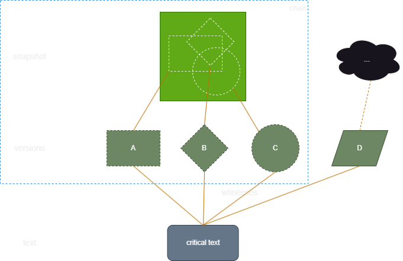

# Modeling an Autograph

## Basic Terminology

Let us first use our case study (GVE) to define some terms we use in the technical documentation with a specific algorithmic meaning.

In the case of GVE, the essential source of epigrams is represented by autograph sheets from handbooks. Whatever its physical support(s), here we call an autograph **sheet** for short.

The main challenge in modeling sheets is that they do not just represent a linear text; rather, they represent a sort of **snapshot** of the creative process which in the author's mind would have led to the intended text.

This is because graphically the snapshot does not just represents a text, but includes many corrections, rethinkings, or refactorings of it, in the form of various types of **annotations** (deletions, insertions, transpositions, side notes, etc.).

The snapshot is thus a sort of picture taken from the author's mind in relation to the text being composed at a given point in time. This does not necessarily imply that this is the end stage of the creative process underlying the text. The process may well have gone further on; but this is not reflected by the snapshot, which just represents a picture which froze an instant of this process at a given time.

The snapshot is thus far from being the carrier of an undisputed linear text; it's an even chaotic bunch of text and annotations on a sheet. It is up to the reader to make sense of these annotations, and try to deduce one or more versions of the text from his interpretation.

The annotations represent changes on the text; but there often is no way to know their relative order, or even their selection when they represent several competing versions of the text. _It is like having all the ingredients_ (our text with annotations), _when we have lost the recipe_ (how to select and order the annotations to generate the intended version(s)).

When for whatever reason an authoritative version of the final outcome of all these operations on the text is lacking, in a traditional (paper) edition usually we are forced to forge one, representing the best effort in interpreting our sheet. Of course, that would just be a best effort; and it might even be the case that we are not sure in deciding among competing interpretations. In the end, we come up with our best recipe.

In a digital edition instead, we have the power to handle all the rich and complex data preserved by our snapshot, without resorting to compromises. We can represent all the ingredients (text and annotations), all the recipes (annotation selection and ordering), and all their outcomes (resulting versions), while still keeping each as a separate layer, so that everyone can evaluate our text reconstruction, and even provide their own alternatives.

Of course, this requires a proper model.

## Model Requirements

Ideally, the main requirements of this model are:

1. we want to represent the _snapshot_ itself in a _computable_ model.
2. we want to preserve as distinct, structured data our _ingredients_ (text and annotations), _recipes_ (annotation selection and ordering) and _outcomes_ (text versions).
3. we want to represent the snapshot annotations both on their _textual_ and _visual_ form. This is because the graphical representation of each annotation is a semantic information, which should be encoded next to the textual variant it represents. By preserving both these layers of data we provide a richer model, which can be inspected by scholars used our digital edition as a tool, or just leveraged by more casual users as another way of looking at the text and its creation process.

A good model should meet all these requirements using the simplest possible structure, which implies _raising the abstraction level_ so that even the finest details can find a generalized and consistent representation.

This also allows our model to lay the foundation of a paradigmatic approach, leading from a single case study to a reusable tool.

## Core Chain Model

Our model core is represented by a general purpose data structure we call **chain**.

The task of this data structure is _representing multiple linear combinations of a set of entities_. We represent these entities as **nodes** of a **graph**, connecting them into linear sequences.

In our specific case, our entities are characters, and their linear combinations build a sequence representing a text. So, a chain has the power of representing multiple texts (i.e. multiple versions of what we regard as the "same" text in the course of its composition) at the same time; and this is right what a snapshot on a sheet does.

### Operations

Let us see how this works by using a simplified diagram. Consider this sheet, which I created by first writing characters `ARZDC`, and then making some annotations on it, representing variations of the text.

A text being a linear sequence of characters, we don't care creating a true text in a specific language here; we just deal with such sequences, so that our examples are shorter and more to the point.

As you can see, our snapshot provides annotations which can be interpreted as operations changing the **base text**, which is just what happens to be the starting point of our digital representation. So, "base text" here has no genetic or philological implication; it is just a practical device in our model. As our model represents multiple versions of what we consider the same text, this means that it represents a set of changes on it, from the first to the last version in the author's mind. Again, "first" and "last" here don't imply that these are the two edges of the line representing the whole creation process; rather, they are the two edges of the segment in this line which is covered by our snapshot.

When representing multiple versions of a linear sequence in terms of changes of a starting sequence, of course we need right that: _a sequence to start with_. This is our "base text".

Often, this base text will correspond to what in a relatively tidy snapshot looks like a line in the main flow of text, used as the anchor for annotations. In our diagram, this is the line where I wrote `ARZDC`.

This does not necessarily imply that I _first_ wrote `ARZDC`, and _then_ all the rest; I might well have written `AR`, then some of the annotations above it, and then the rest of the letters in the same line (`ZDC`); or I might have followed any of the other order of actions I could ever imagine for writing the text photographed by our snapshot. This is not relevant here; all what we want is a sequence to start with, and on the ground of both visual and textual representations (and optionally their meaning, when dealing with a real text) I happen to pick `ARZDC`.

Having defined our base text, let us now focus on the annotations. The annotations on our snapshot clearly represent _operations_ on the text, which in a visual way lead to generate different versions of it:

- the slash on `Z` represents a _deletion operation_.
- the slash on `R` is part of a _replacement operation_. Of course, in simpler terms a replacement is just a composite operation, made of a deletion followed by an insertion. Yet, from our more synthetic point of view we prefer to look at it as a replacement. In fact, that's what our snapshot visuals aim to represent; we have a slash on `R`, and two segments originating from it and leading to two alternative letters: `V` on the left, and `P` on the right.
- in turn, the slash on `V` is another _replacement operation_: here it gets replaced by `B`. Note that in this case we are nesting an operation on top of another operation; which, in turn, happens to be on a branch representing two alternative operations. One branch stems from `R` and goes across `V` up to `E`; the other one stems from `R` and goes up to `P`. It is our conventional interpretation of these visuals which defines these operations, and in some cases even hints at their relative order.
- finally, the arrow on top of `DC` represents a _movement operation_: `C` is moved before `D`. Again, this is a higher-order, complex operation that we could just represent as a deletion (delete `C`) and an insertion (insert `C` before D); but we prefer a complex operation here, as it best fits what we clearly understand about the writer's intention when seeing the arrow "moving" `C` before `D`.

So, all of our _annotations can be modeled in terms of operations_, which affect our chain.

Also, we do not just limit ourselves to basic operations like insertion or deletion. Even if these would be all what is strictly required to represent any change on a linear sequence, we want a model as near as possible to a human-friendly representation and interpretation of our snapshot.

This is because operations here essentially belong to the layer of interpretation, and interpretation here is a human fact. Here, we are looking at our _snapshot_, and inferring operations from its visuals. The _snapshot is objective, empirical evidence_: we effectively take a photographical image of it, and we could even geometrically represents all its visuals.

Conversely, _operations are our interpretation of these visuals_, which define the ingredients of our lost recipe: the letters of our text, and the operations which change their combinations into sequences.

We thus want such operations to be as close as possible to a human-friendly way of thinking; and for this reason we allow for many complex, higher-order operations, as far as they best fit our needs.

### Chain

So far we have modeled our snapshot and its ingredients: we have letters, and operations on them. Some of these operations just move letters around; others can delete them, or add new ones.

Our next challenge is representing a recipe. In our sample snapshot, our ingredients are:

- the base text `ARZDC`;
- the deletion of `Z`;
- the replacement `R=V`;
- the replacement `V=B`;
- the replacement `R=P`;
- the movement of `C` before `D`.

As we have seen, these operations already imply a degree of interpretation; but in most cases this is a trivial interpretation, which poses no issues.

The main issue for interpretation is instead _selecting and ordering our ingredients_, that is, building a **recipe** for handling them in a way leading to a final outcome, which in our case is a version of our base text.

In other terms, we have six ingredients listed. Among them, five are operations. Now, should I select all of them to build a specific version, or just a subset? And what would be their order of application? We need at least one recipe, or even more than one; each of them will represent an interpretation of our snapshot leading to a specific version of our text.

So, recipes are completely up to our interpretation: of course, they are constrained by the number and type of available ingredients; but within these limits, any combination is possible. It is up to scholar's judgement to consider all the complex factors behind a recipe, and define it, thus generating one or more versions of a text.

Notice that our model will always include all the ingredients, as we want to fully represent our data at the snapshot level. We do not want any of our interpretations have destructive effects on our data: just like the snapshot presents all the ingredients mixed together, we want to collect and preserve all of them as distinct entities. This will not only ensure that our model fully represents our data; but also that we can add as many interpretations as we want on top of them, or even allow others use the same data to come out with their own interpretations.

So, the challenge here is having a model which allows scholars to define a recipe for combining ingredients to get any number of distinct text versions, while still containing all the ingredients in the same box. In a sense, if you think of a text as a string (a linear sequence of) characters, it is like wanting a time-enabled string, i.e. a single data structure with the ability of representing not just a single sequence, but many different ones, all within the same box.

TODO

In fact, except for trivial cases we can't know the relative order of these annotations; we have the ingredients for building the text, but we lost the recipe.

This data structure consists of a linear sequence of nodes, each connected to the previous and the next node by a link.

Additionally, each link has a version tag, which adds the dimension of time to this structure. Internally, this structure collects nodes and links, and once they are added, they cannot be removed (unless we are using a single version). Any modification is done by adding new nodes and links, which connect or disconnect or reorder the existing nodes.

When the chain is empty, there are no nodes or links. When there is at least one node, there always are links for the head and the tail of the chain. So, the structure, when not empty, always alternates links and nodes, starting and ending with links.

This structure allows to represent different states of a text in time, after operations change it. Each operation introduces a new version (unless you are overwriting the previous version), so that building the text for a version is done by just following the path defined by links among nodes. At any time, you can build the text for any version, while still using a single object to represent all of the versions.

Operations usually add new links, and optionally add new nodes; anyway, both nodes and links are immutable items of an unordered set.

## Chain Operations

Chain operations are abstractions on top of the chain structure, used to represent higher level editing operations on the chain's text. These operations serve as an intermediate layer between client code with user-friendly models and the chain model itself.

Each chain operation derives from `ChainOperation<T>`, which in turn is derived from `VarOperationMetadata`.

All these operations get translated into calls to chain editing methods, which are more low-level and directly work on nodes. The chain operations take care of finding the nodes corresponding to their location arguments.

Chain operations work on a chain operations **context** (`ChainOperationContext<T>`), which includes the chain itself and a set of related data:

- the **last version tag** being the output of the last operation executed on this context.
- the **features** of the context. These get added (or updated or removed) when executing operations.
- thoe **node features**. This is a dictionary whose key is a tuple built of node ID and version tag, and value a list of features.
- the **steps** executed on the chain, each including:
  - input version tag;
  - output version tag;
  - context and nodes features snapshot, taken after the step;
  - reference to the source operation object.

The general text-based syntax for these operations includes these components, from left to right:

1. `(IN-OTAG:OUT-OTAG)`: these are the input and/or output tags. These tags are different from the interpretative tags used as filters for applying operations; they belong to the chain's model, and represent the input and the output states in the chain before and after applying an operation. You can specify none, just one, or both.
2. `ATxRUN` or `@ATxRUN` (required): node ID or index (when prefixed by `@`) optionally followed by the run of nodes. If not specified, the run defaults to 1.
3. `OPERATOR` (required)
4. `"VALUE"`
5. `^RANK`
6. `[TAGS...]`: tagged ordinals, separated by space, used to filter operations in or out according to the editor's interpretation.
7. `{NAME="VALUE"...}`: name=value pairs representing features. The operator can be `=` or `:=` for unique features. A name containing spaces must be included in double quotes.

The available operations (and their corresponding operator in their text-based representation) are:

- replace (`=`): e.g. `3x2="X"`
- delete (`-`): e.g. `3x2-`
- add before (`+[`, `RUN` is always 0): e.g. `3+["X"`
- add after (`+]`, `RUN` is always 0): e.g. `3+]"X"`
- annotate (`:`): e.g. `3x2: {note=sample}` (node-scoped) or `0: {note=sample}` (context-scoped)
- move before (`>[`, `TO-RUN` is always 0): e.g. `3x2>[6`
- move after (`>]`, `TO-RUN` is always 0): e.g. `3x2>]6`
- swap (`<>`): e.g. `3x2<>6`

As for features (included in braces), `name` can have these prefixes (in this order):

1. `!`: the feature should be removed.
2. `*`: the feature targets context rather than nodes (which is the default, unless `AT` is 0).
