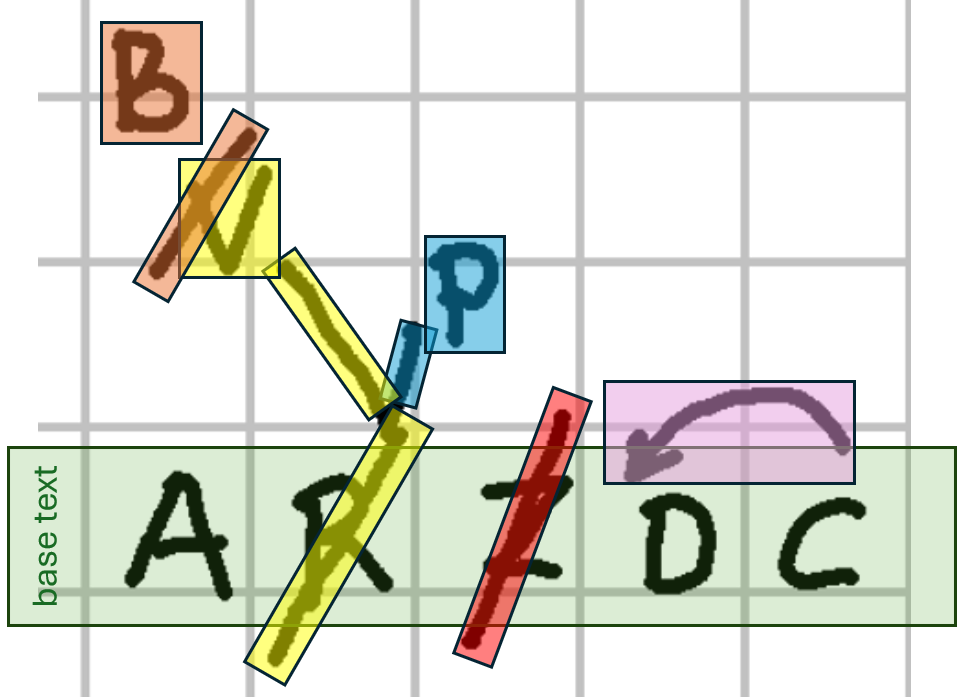

# Diplomatic Model

On the diplomatic side, our model should provide an at least approximate graphical representation of the snapshot.

First, note that this is not a requirement for the textual side of the model; we could just implement this without its graphical counterpart, which in some cases might be less relevant or too costly. So this is just an additional part of the model, which is anyway designed to preserve the separation between these two layers.

As we have seen, the core of the textual model is represented by the chain structure, and by operations acting on it. Each operation is an act executed on the text, and in most cases corresponding to some graphical representation in the snapshot.

For instance, consider our usual mock snapshot:

Here I have highlighted each portion of visuals with a different color, corresponding to the operations represented by the snapshot:

- the red bar on top of `Z` represents its deletion.
- the yellow bar on top of `R`, continued to the left up to a `V`, represent a replacement: `R` is replaced by `V`. The visuals here are 3: two segments and a `V` letter.
- the orange bar on top of `V` and the `B` drawn above it are the visuals corresponding to another replacement. This time, `V` is replaced by `B`.
- the magenta arrow on top of `DC` represents a movement operation: `C` is moved before `D`, or alternatively, `D` and `C` are swapped. As in many other cases, here the choice depends on the one which best fits our interpretation.

So, at this level of abstraction, any annotation in our snapshot can be graphically represented by a set of visuals, corresponding to any mixture of geometric shapes and/or text, whatever its complexity.

As annotations are modeled as operations, this means that we can add the graphical representation of each operation as a set of visuals linked to it. This is essentially what is done by the diplomatic portion of the model, which adds these metadata to operations:

- `g`: the SVG `g` element graphically representing the operation this diplomatic information is attached to. SVG being XML, this is just a string in the object model. SVG here is the ideal candidate for this graphical representation, because it's a W3C standard for vector and interactive graphics in HTML pages. As an XML dialect, SVG can represent any geometrical form or text, with all its visual features, just with some text; and this is compatible with both HTML and XML, including of course TEI. Also, it can be made interactive and animated by controlling each of its elements via JavaScript. An SVG `g` element is a group, which may contain any type and number of shapes or texts, or even other groups. So, a single `g` element for each operation can represent any complex visuals for it, as a single unit.
- `features`: a set of generic features attached to the operation as a whole and related to its diplomatic aspects. For instance, we might want to add information about ink, size, etc. Features are modeled as already seen for the textual portion (name/value pairs).
- `element features`: this is a dictionary of features sets, keyed under SVG element IDs. The dictionary allows to attach features to a specific element of the operation visuals, rather than to their whole set. To this end, you assign an arbitrarily chosen ID to every SVG element you want to attach features to, and then add as many features as needed to it under the key of its ID. For instance, we might want to add a specific set of features to only the orange bar among the two visuals building the group representing the replacement of `V` with `B`.

So, this model not only links visuals to each operation, but also attaches optional metadata on the diplomatic side, both to the operation as a whole, or to any parts of its visuals. Yet, the model is very simple, because it rests on just text: SVG code for the visuals, and name=value pairs for features.
