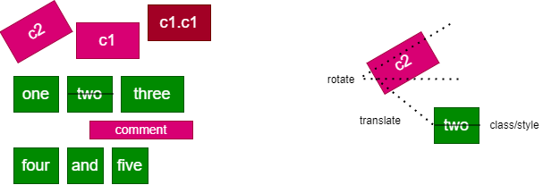
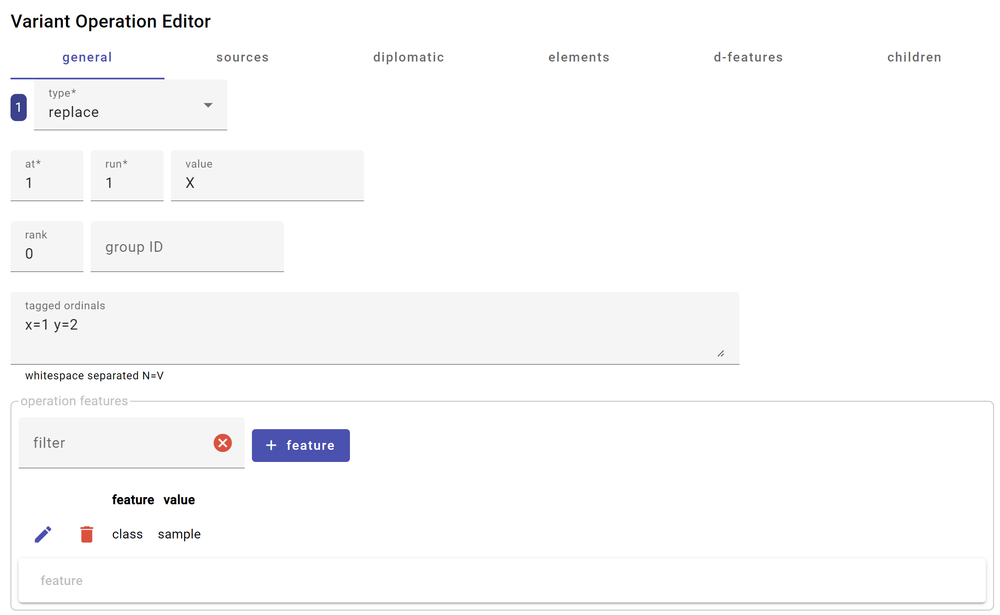
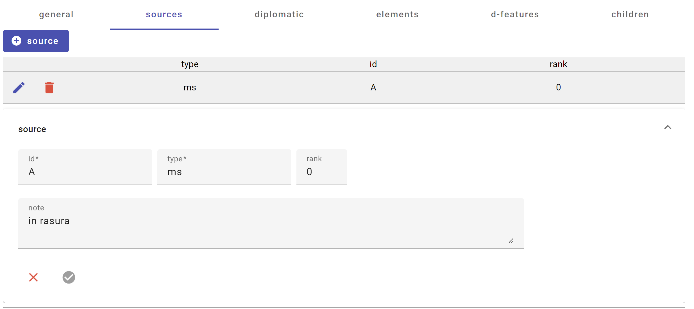
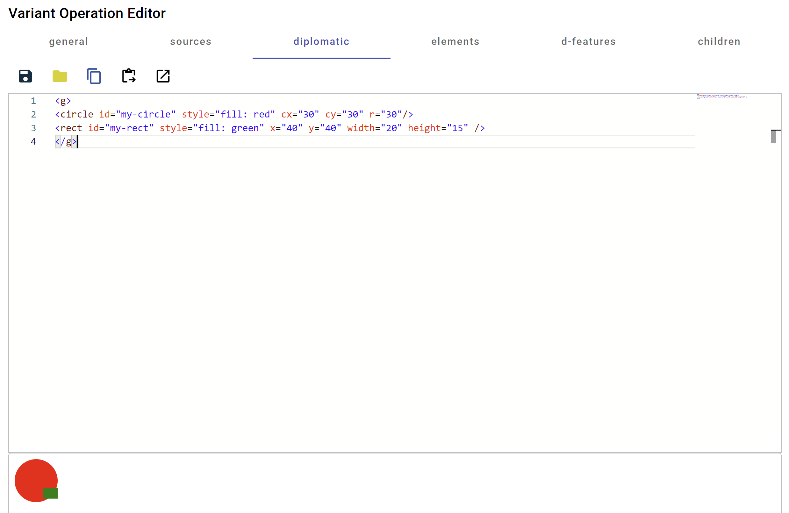
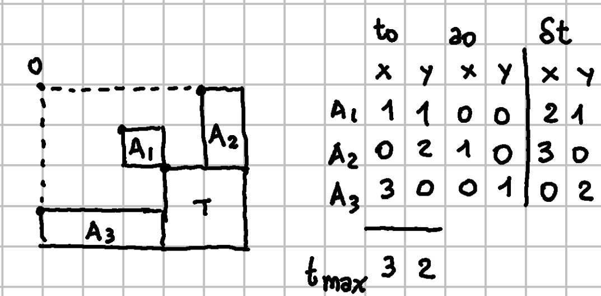
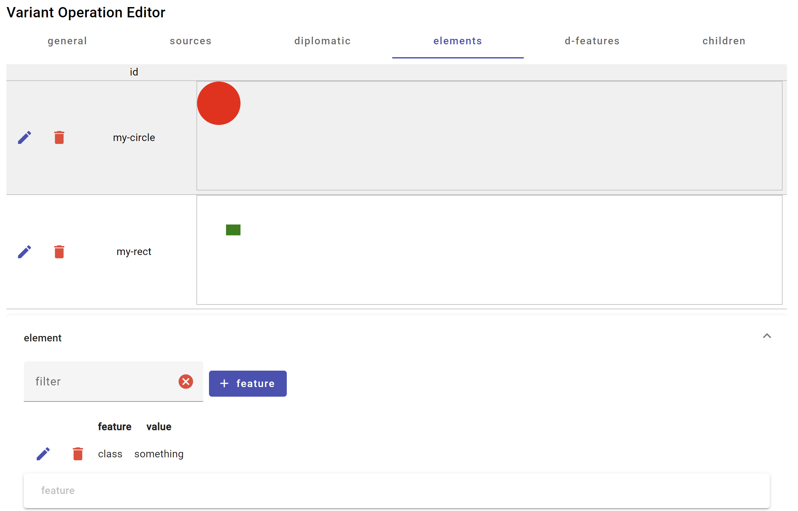
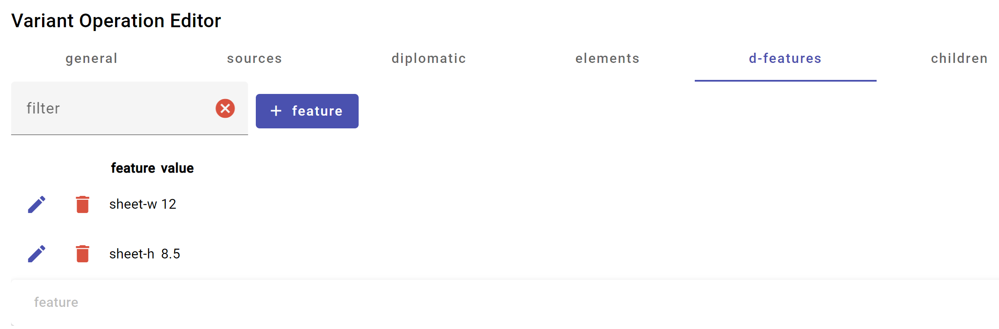

# Diplomatic Model

The diplomatic model represents the graphical layout of the variants attached to the base text. Essentially, it is a set of metadata optionally attached to each operation, whatever its plane.

As for the _general layout_, the main assumptions are:

- the **base text tokens** ("words" in a graphical sense, i.e. sequences of characters delimited by whitespace) are laid out linearly on a single row, until line end; after line end, they continue on the next row. Line end is represented by a newline character in the base text. So, the base text tokens position is automatically determined by the layout algorithm.
- the **annotations** on top of each base text selection are always positioned _relative_ to the starting point of that selection.

So, consider this picture, where the right side is just a more detailed legend about positioning tokens. Here the origin tokens are colored in green, and are distributed in two lines, according to the original layout.



Child tokens are colored in magenta, and grand-children tokens in red. In this example, we have:

- an origin token, `two`;
- two child tokens of `two`:
  - `c1`, in turn having a child token:
    - `c1.c1`
  - `c2`, sibling of `c1`.

So, descriptively this means that:

- the original token was `two`;
- then two variants came out from `two`, `c1` and `c2`, not necessarily in this order.
- then, another variant `c1.c1` came out of `c1`.

## Metadata

Any variant generation operation has these metadata:

- `id`
- `rank`
- `groupId`
- `features` (list):
  - `name`
  - `value`
  - `isUnique`
- `taggedOrdinals`
- `sources` (list):
  - `id`
  - `type`
  - `rank`
  - `note`

The diplomatic model adds a `diplomatic` property which is a complex object:

- `diplomatic`:
  - `g`: the SVG `g` element graphically representing the operation.
  - `features`: the optional generic set of features attached to the text variant as a whole (e.g. type, size, etc.):
    - `name`
    - `value`
    - `isUnique`
  - `elementFeatures`: the optional features attached to elements defined in `g`. Each element is identified by its `id` attribute, which is a key in this dictionary of `Feature` objects:
    - `name`
    - `value`
    - `isUnique`

### SVG Features

The most relevant aspects of SVG you can encode as features are listed here as a quick reference.

#### SVG Styles and Classes

In addition to setting attributes on objects, you can use CSS to style fills and strokes. Anyway, not all attributes can be set via CSS. Attributes that deal with painting and filling are usually available, so fill, stroke, stroke-dasharray, etc. can all be set this way.

You can also wrap several CSS properties into a class and add it to each SVG element.

#### SVG Shapes

- `rect`: `x` `y` `width` `height`, plus `rx` `ry` for radius of the corners.
- `circle`: `cx`, `cy` (center), `r` (radius).
- `ellipse`: `cx`, `cy` (center), `rx`, `ry` (radius).
- `line`: `x1`, `y1`, `x2`, `y2`.
- `polyline`: group of connected straight lines: `points` is a list of points where each number is whitespace/comma separated: e.g. `10 15, 30, 40`.
- `polygon`: a closed `polyline`. The path automatically connects the last point with the first, creating a closed shape.
- `path`: the most general shape, `d` contains drawing instructions. It combines multiple straight lines or curved lines. Each command is a single letter; uppercase for absolute coordinates, lowercase for relative coordinates (with reference to the last point). Coordinates here are always unitless.
  - `M` = move to: `x y`, without drawing a line.
  - `L` = line to: `x y` (from the current position). Abbreviated forms with a single parameter are `H` = horizontal line, `V` = vertical line.
  - `Z` = close path.
  - `C`, `Q`, `S`, `T` = Bezier curves.
  - `A` = arc (section of ellipses).

#### SVG Texts

The `text` element has `x` and `y`, and the text is its content. Other attributes:

- `text-anchor`: `start`, `middle`, `end` or `inherit`.
- `dominant-baseline`: vertical alignment.
- `fill`
- `stroke`
- CSS-like attributes for font: `font-family`, `font-style`, `font-weight`, `font-variant`, `font-stretch`, `font-size`, `font-size-adjust`, `kerning`, `letter-spacing`, `word-spacing` and `text-decoration`.
- `tspan` used inside a `text`, like `span` in HTML.
- `textPath` draws text on a path, e.g.:

```xml
<path id="my_path" d="M 20,20 C 80,60 100,40 120,20" fill="transparent" />
<text>
  <textPath xmlns:xlink="http://www.w3.org/1999/xlink" xlink:href="#my_path">
    A curve.
  </textPath>
</text>
```

#### Images

SVG has an `image` element to embed raster/vector images. The specification requests applications to support at least PNG, JPEG and SVG format files.

The embedded picture becomes a normal SVG element. This means, that you can use clips, masks, filters, rotations and all other tools of SVG on the content.

#### Attributes

Most important attributes:

- `fill`
- `stroke`
- `fill-opacity`
- `stroke-opacity`
- `stroke-width`: the width of the stroke from its path to both edges.
- `stroke-linecap`: `butt`, `square` (stretches the stroke), `round` (rounded at end).
- `stroke-linejoin`: `miter`, `round`, `bevel`.
- `stroke-dasharray`: comma separated numbers (first for the filled area, second for the unfilled area).

#### Transforms

You can use `g` to group elements for transformations. The `transform` attribute can use one or more functions, separated by spaces, like:

- `translate(x,y)`
- `rotate(d)`
- `scale(x,y)`
- `skewX(d)`
- `skewY(d)`
- `matrix`: a 2x3 transformation matrix. To combine several transformations, we can set the resulting matrix directly with the `matrix(a, b, c, d, e, f)` transformation which maps coordinates from a previous coordinate system into a new coordinate system. See [here](https://developer.mozilla.org/en-US/docs/Web/SVG/Attribute/transform#General_Transformation) for more.

## Flow

The general flow for building diplomatic models is as follows:

(1) a GUI editor assists users in editing diplomatic data for each text variant operation.

(2) data are saved into a database.

(3) the visualization app gets a base text and all its variant operations. It displays the base text, and then also each operation having diplomatic data.

To display each operation:

1. the app requests its diplomatic data to the API.
2. the API fetches data from the database, and parses the SVG code from the `g` property, building a hierarchy of objects, each with its `id`, and with all its features as merged from the payloads in the element features dictionary. It then returns the SVG code and this parsed hierarchy.
3. the app injects the SVG code in its visualization (it will be a `g` child element of the main `svg` element), and updates its list of element viewmodels, as specified by the received hierarchy. For each of these viewmodels, it queries the DOM to get a reference to the element representing it, as defined in SVG. It then attaches this reference to the viewmodel (via the shared `id`), so that later we can add interactivity to these elements in the SVG diagram.

## Operation Editor

The operation editor is structured into 6 sections:

- **general**: operation type, arguments and coordinates, tagged ordinals, and features.

Each operation has an ID, automatically assigned. This is not used in the context of the operation or of its transformations, but is provided as a reference. Most general parameters represent the arguments for the operation.

Tagged ordinals represent the interpretation level, and provide 1 or more tag=ordinal pairs, which link a specific text version tag (which is an arbitrary string) to an ordinal number. This number specifies the order of execution of operations. So, if you have two versions A and B, it might happen that for version A an operation is executed as the first one (A=1), while for B it's executed as the third one (B=3). For quicker edit, tagged ordinals are input as tag=ordinal pairs, separated by space.

Features represent metadata attached to this operation. These can be any type of name=value pairs.



- **sources**: a special type of metadata used when your text versions come from more than a single source. In this case, you can specify the source(s) for each operation, just like in a traditional apparatus you specify witnesses for each variant. Each source has an ID, a type, a probability rank (0=not specified, else 1-N), and an optional free text note.



- **diplomatic**: this contains the SVG code with the visual representation of this operation. The visual representation is referred to the base text. Here you are free to type or paste the SVG code you want, provided that its root element is a `g` element.

The diplomatic section is the approximate diplomatic representation of the layout of the annotated text. It essentially consists in a freely editable SVG code, always grouped into a single root `g` element, encoding all the graphical traits representing this operation.



The toolbar allows to save, load, copy, or paste code, or to open a user-defined SVG editor to use (the default is <https://editor.method.ac/>).

At the bottom you can see the rendition of the SVG code.

As we want to position this representation with reference to the base text, you also have two coordinate pairs for the upper left corners of the base text (`tox`, `toy`) and of the annotation area for this operation (`aox`, `aoy`).

>In the model, these data are stored as _features_ of the operation; but in the UI they appear in their own controls, so you can directly act on them and see the results. In fact, whenever you change any of these values, base text or annotations will be translated accordingly.

These coordinate pairs are used locally for each edited operation, independently from the others. This allows users focusing on the edited operation, without caring about its synchronization with all the other operations on the same base text.

When editing a single operation, you just setup these coordinates so that the topleft object origin (either it refers to the base text or to its annotations) is aligned with the SVG root `g` element origin. When rendering the operation preview, this is all what is required. Then, when rendering a set of operations on top of the same base text, the renderer will take care of recalculating the origins accordingly to fit all the operations and their base text.



The above figure shows the procedure used by the renderer for translating the origins of the various operations in the chosen set. This is sampled by 3 annotations A1, A2, A3 on top of a base text T. Each operation has its own set of tox and toy coordinates (listed to the right of the picture).

1. collect the max values for `tox` and `toy`. In this example the values are 3 and 2.
2. for each operation, calculate `max(tox) - tox` and `max(toy) - toy` (`δt` in the figure).
3. for each operation, translate operation origins (`tox`, `toy`, `aox`, `aoy`) by `δt`.

- **elements**: lists all the SVG elements having an `id` attribute in the SVG code of the diplomatic section. The ID allows you to attach any number of features (metadata modeled as name=value pairs) to each of these elements.

Among these features, you may use `style` or `class` for renditional purposes, and any other name for your own metadata.



- **diplomatic features**: features for the diplomatic model as a whole, rather than attached to specific elements of it.



- **children**: for operations stemming into a tree, this contains the tree of its descendants. The children section is available only when the operation type is `replace`, and is used for those operations stemming into a tree of descendant operations, on the annotations plane. In this case, you start by adding a root operation, and any number of descendants on top of it. Each operation can be fully edited in an embedded operation editor.

>The embedded editor lacks the children section, because the full tree of operations is edited at the top level.
