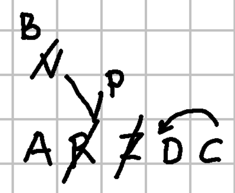
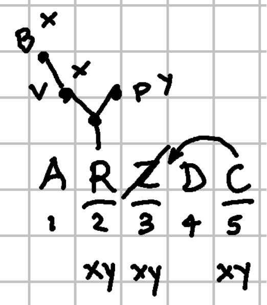
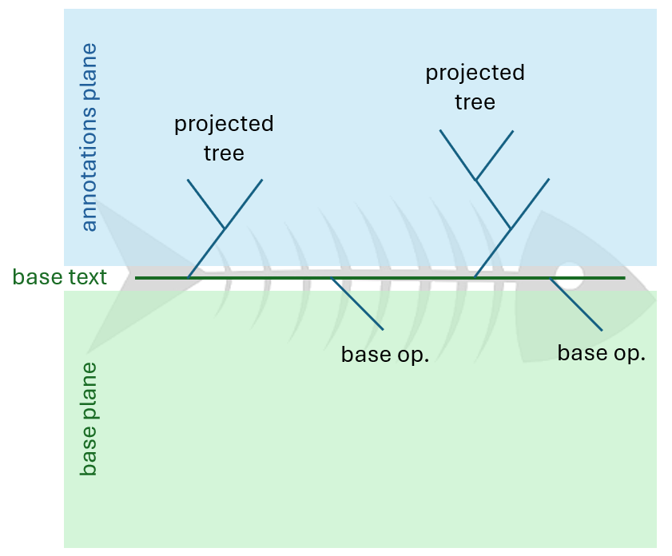

# Introduction

- [Introduction](#introduction)
  - [Text and Variants](#text-and-variants)
  - [Layers](#layers)
  - [Rules Families](#rules-families)
  - [Spine Shaped Apparatus](#spine-shaped-apparatus)
  - [Higher Order Entities](#higher-order-entities)
  - [Content Creation](#content-creation)

## Text and Variants

At the level of a single epigram, the focus is on modeling a text with all the variants defined for it by its annotations in their original sheet of paper. The challenge here is representing a virtually high number of different text versions, as defined by the base text and its annotations.

In our text, we deal with a handwritten original, lacking any authoritative publication; the sheet, mostly by the hand of the author himself, captures a snapshot of the text generation process.

Consider this diagram, where each letter stands for some portion of a text; as you can see, the author has placed a lot of annotations on top of a base text, representing deletions, replacements, insertions, movements, and the like.

The annotations represent operations on the text, like replacements, insertions, deletions, etc. Applying these operations produces other versions of the text. Yet, the problem is that we have no systematic and formal definition for these operations; we just have what we can infer from the annotated text on the sheet of paper.

In fact, except for trivial cases we can't know the relative order of these annotations; we have the ingredients for building the text, but we lost the recipe.

For instance, in the above picture our ingredients are a deletion, a replacement with different variants, and a movement. Do all these operations belong to the same version? And what's their order?

As editors, we have to provide some answers, by adding one or more interpretations on top of this snapshot, each generating a different text. We will thus have different recipes, each selecting a certain subset of the ingredients, and defining a certain order for their usage.

For instance, a recipe might say that for version `x` of our text I first pick the deletion of Z; then the replacement of R with first V, and then B; while the replacement with P is left out, as not belonging to this version of the text. Finally, I pick the movement of C before D. So, version `x` will end up with text `ABCD`.

This means that we do not start with two or more versions of a text to be collated to select and encode their differences; rather, we start with a single text, with annotations whose effect is changing it, generating different versions.

## Layers

If we try to model this, we can start with 3 basic layers:

- the **base text**, as provided by our snapshot. This can be modeled as a set of lines, each including a set of tokens (in the sense of graphical words).
- the set of all the **annotations** on top of the base text, again provided by the snapshot. In turn, this can be divided into two subsets: one directly works on the base text, like deleting Z, or moving C; another relies on annotations projected on a tree-shaped structure stemming from a selection of the base text. For instance, in the above figure R is replaced by V, and then by B; or by P.
- the set of all the **interpretations** we want to add to these ingredients, thus creating one or more recipes to build our text. The interpretations layer is a set of interpretations, which essentially select and order the operations, optionally adding further metadata to them. For instance, the interpretation leading to version `x` of our sample text defines a specific order for base text operations: first delete Z, then replace R with V and B (but not with P); and ● finally move C.

So, now our variants are not the difference between two versions of the same text, as provided by two witnesses; rather, they are the outcome of editing operations on the base text. Our variants are thus encoded as generative rules, each representing a specific operation with its metadata.

In the figure below you can see the interpretation layer annotated with `x` and `y` representing two different versions of the text:

To start with, the base plane contains our text. It also includes base rules on top of it, like here the replacement of R, the deletion of Z, and the movement of C.

Now, one or more interpretations define their selection and order:

- version `x` interpretation starts deleting Z; replaces R with V and then B; and then moves C before D.
- version `y` starts deleting Z; replaces R with P; and moves C before D.
- then, on the annotations plane we have a tree-shaped projection from `R` with its nodes for `V`, `B`, and `P`; and again, on top of it our interpretations for these two versions of the text.

So, we end up with two hypotheses for our text: version `x`, with `ABCD`; and version `y`, with `APCD`.

The beauty of this approach is that, while separating information in different layers, it allows not only to generate different texts; but also to show the living process of their generation.

So, this is not only a philological model to build variants from a base text; but also a paleographic model to give an approximate representation of our snapshot in a computable way. It is right this paleographic model which will allow us to produce interactive outputs, where you can animate each change in the base text.

In this model, we start from the base text, as defined by lines and tokens. Then, we try to reproduce the graphical representation of each operation as it appears on our sheet; so:

- the rule deleting Z is graphically represented by a diagonal trait on it.
- the rule replacing R with V is graphically represented by two segments leading from R to V, and by V itself.
- the rule further replacing V with B is graphically represented by another segment leading to B.
- the rule replacing R with P is graphically represented by yet another segment, and the P itself.
- finally, the rule moving C before D is represented by the arrow on top of C.

So, just like we model text variants as rules, we model their paleographic representation as metadata of these rules.

## Rules Families

So we have two families of rules, according to their plane. Base plane rules all reference the same input, as frozen into our snapshot; their selection and order is fully driven by our interpretations. Annotation plane rules instead are nodes on a tree, stemming from the spine represented by the base text.

This implies that internally the behavior of these rule families is very different, because on one plane our starting point is frozen, while on the other one it moves along the branches of a tree.

Nonetheless, our abstraction level is high enough to make these two families similar, so that we can rely on a uniform model.

In fact, all the rules share this model, which provides metadata about the text transformation process and their paleographic representation. This is encoded via SVG, which allows for any order of complexity in it, while still relying on a W3C standard and allowing for highly interactive and animated presentation in user interfaces.

## Spine Shaped Apparatus

We can label this kind of apparatus model as a _spine-shaped apparatus_. The apparatus is no longer a repository of variants, but rather a set of rules, which either work directly on the base text (in the base plane), being our spine; or stem from it as trees (in the annotations plane).

Graphically, we can thus imagine this as a spine capable of branching at each of its points into one or more segments connecting the nodes of a tree.

## Higher Order Entities

Of course, our epigrams do not end here. That's the core model for each single text; but in turn it will fit into larger models, representing other entities like epigrams, collections, persons, etc.

In an epigram, our text model with its rules, paleographic data and interpretations can be represented inside a bigger, composite model, the spine-shaped apparatus layer. As a metatextual layer, this sits on top of a base text, and provides specialized annotations for it. In our case, the annotations correspond to our rules, with their metadata. But we could add as many layers as we want to represent any other type of metatextual data on top of the same base text.

All these layers would be objects with their models, just like the text itself; and all these objects would be inside a box representing our record, in this case an epigram.

The same box might include any other type and number of parts, even with no relation with text: for instance, highly structured data about the epigram, or about the physical sheet with our snapshot.

Again, on a higher plane we would then have many other records to represent larger or different entities, like collections of epigrams, persons, etc. All such entities would be boxes, where you are free to put any part.

## Content Creation

What I've just described is the architecture of an existing content creation framework, Cadmus. While the spine apparatus is totally independent, by adopting such editor at this stage we can integrate in a single environment any type of data we want to add, either it's textual, meta-textual, or non-textual at all.

Of course, Cadmus is just a tool for creating complex data; once we have done this, we can dispose of it completely. That's just software for creating complex models like these.

In a Cadmus-based editing environment, each epigram is an item (=a record), composed of several parts. Among them, two core parts are used to represent the text and its spine-shaped apparatus, designed to generate all the variants according to their description and interpretations:

- _base text part_: the base text, stored line by line.
- _spine-shaped apparatus_: this is an apparatus based on the GVE model, which can be represented as a spine. The spine contains operations on the base text, optionally branching into trees. The apparatus contains any number of entries, each including a location (just like any other Cadmus layer fragment) and a GVE base operation.

🛠️ As GVE uses a simpler and independent model for addressing text, an adapter is used to convert between Cadmus token-based **coordinates** (as used in most layer parts) and GVE coordinates.

Cadmus token-based coordinates are represented by 1 or 2 text points, each having:

- `Y`: the line ordinal number (1-N).
- `X`: the token ordinal number (1-N) in the line. A token in each line is defined as any sequence of characters separated by space. It is assumed that whitespaces are normalized and lines are trimmed, so in the end you find a single space separating each pair of tokens.
- `A` (at): the optional ordinal number (1-N) of the first character of the token to start the selection from. When 0, this means that the whole token is selected.
- `R` (run): the optional count of characters to select starting from `A`. This defaults to 1 when `A` is greater than 0.

You can have 1 or 2 such coordinates, named A and B. When only A is present, text is selected from a single token. When both A and B are present, text is selected from A to B as a range, which could span many tokens and/or lines. In such ranges you can also use `AR` to start the range from the `A`-th character of A's token, and/or end it with the `R`-th character of B's token.

The epigram may include many other generic or specialized parts in its item, to represent any type of related metadata. Also, bigger entities like collections can be represented as items too, and thus edited in the same centralized environment.
