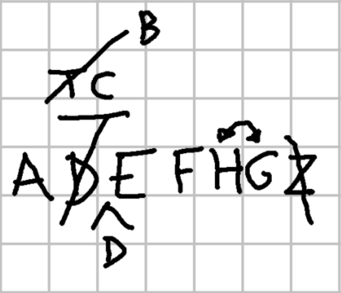
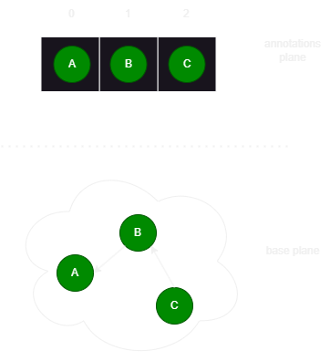

# Philological Model

In this model, we start by distinguishing two separate planes:

- the **base text**, as produced in the first act of writing on the document.
- the **annotations** on top of it, representing all the changes to be applied to the base text to get to any of its variants.

>>"First act of writing" is only a pragmatic device; it does not imply that the whole original text has been written out, and then another version came out. It is just a graphical, descriptive concept: it's the token which was written first, relative to other tokens which were added later. In a sequence like ABC, where B has been deleted and replaced by X, maybe the author just wrote A; then B; then he immediately changed his mind, deleting it and writing X above it; and then continued with C; or any other possible scenario. Here we are just seeing the resulting text from the perspective of an observer who looks at the final state of the text, with all its annotations, and just discriminates between tokens in the original, "normal" layout, and all the others.

Consider this abstract example:



Here, the base text is `ADEFHGZ`. Then, a number of operations are graphically represented as changes to be applied to it; it's a like having a recipe for its transformations.

These transformations have a different behavior according to the plane they are located on.

## Base Plane

On the **base** text plane, the model assumes that:

(1) **the order of base operations is not determined in advance**. This is data which will be superimposed by interpretation(s) on top of them; but as they all are on the same original support in the same base plane, they just belong to a snapshot, as if they were all happening at the same time on the same text.

>For instance, in the sample snapshot only interpretation could say (with a variable level of certainty) whether the operation on top of `D` happened before or after the one on top of `Z`.

(2) **none of the base operations work on the result of another base operation**. This is because they are all laying on the same plane, that of the base text. Nested operations are allowed only for operations on the other plane, the annotations plane.

>For instance, in the sample snapshot `TC` replaces `D`, and _then_ `B` replaces `T`. Unless recurring to interpretation, we can't know whether e.g. the operation on top of `D` happened before or after the operation on top of `Z`. Inversely, we can be sure that the operation nested on the `TC` replacement, which further replaces its `T` with `B`, happened after the `TC` replacement itself, as it graphically stems from it.

(3) **each base operation works on a selection of the text which cannot overlap with that of any other base operations**. The author writes the base text, and variously annotates it with our base operations; these refer to a specific portion (that we call _selection_) of it. Then, the annotations may stem one from the another, freely expanding, nesting, or even branching; but in the beginning, the selection is one, and it represents the ground on which a whole tree of other operations can be planted. So, if more than a single operation is done on any selection, it's encoded in the tree, while the selection remains unique and non-overlapping with other selections.

So, in the end base operations work on a selection of text. They have a type (deletion, replacement, movement, etc.) and they generate a variant text either directly, or by means of operations nested on the annotations plane.

For instance, in our sample snapshot the base operation deleting `Z` directly generates a text variant (without the final `Z`); while the base operation replacing `D` with something else (first `TC`, then `BC`) generates multiple text variants by walking the tree of the operations nested on top of it in the annotations plane.

## Annotations Plane

On the annotations plane, operations are free to nest and even branch, by organizing them into a **tree**. The tree is then walked from the root up to the end of each branch.

Each **node** of the tree represents an operation, whose result may or not be _interpreted_ as a variant. Again, it's up to interpretation deciding whether the result of each node is just a stage towards another variant, or determines a variant in itself (then optionally subject to further changes for further variants, if this is not a terminal node).

>For instance, in our sample snapshot the tree on top of `D` replaces it with the result of two nested operations, which generate first `TC`, and then `BC`. Only interpretation can say whether the intermediate stage `TC` should be treated as a variant in itself (thus producing `ATCEFHGZ`, if the base operation on `D` is regarded as the first one), or rather it's just a step towards it (thus directly producing `ABCEFHGZ`). As already stated, we want to keep interpretations distinct from the representation of operations.

## Structures

So, our model should be able to:

- represent base operations on the base text plane.
- superimpose one or more interpretations to the base operations for their order and the resulting variants.
- represent tree operations on the annotations plane.
- superimpose one or more interpretations to the tree operations for the resulting variants, and their combinations with the base operation they stem from.
- provide an approximate representation (a virtual snapshot) of the graphical layout which puts together the base text and the annotations on top of it, combined with the operations represented by it.

This is a challenging task, so let us face it one piece at a time. Let us first start from the model for the base text plane.

### Base Plane Model

A base plane contains:

- the **base text**. This is just a string. Words (or better, tokens, which are defined as the sequence of characters delimited by whitespace) are separated by a single space or by a newline in it.
- the **set of base operations** working on various selections of the base text. As stated above, no of these selections overlap, and base operations cannot be nested. Their order will be defined by one or more interpretations.

Defining edit operations for a base text would be trivial; but the problem here is that all these operations are defined with reference to the _same text_, at the _same moment_ of our snapshot. So, while the machine needs to process a single operation at a time to generate the variant text, and each operation changes the base text, we must still refer the next operation to the _unchanged_ base text, just like it is in the snapshot.

For instance, consider our sample snapshot: say we start from the operation on top of `D` which replaces it with `TC` or `BC`. Both these results end in inserting an additional character in the base text. Yet, all the other base operations do not care about the result of other base operations, because their order is not predetermined, and we thus designed them not to be nested. So, it is as if each base operation worked on the text on its own, without caring about other operations; even though the final result is the combination of all of them, in the ways defined by their interpretations.

Thus, if we define an edit operation by looking at the character's ordinal number in the text, we can say that the operation on `D` works on character 2; and that the operation on `Z` works on character 7. Yet, when we execute the operation on `D`, we get an additional character after it; which means that all the other ordinal-based operations will be broken, because the number of characters has changed. To avoid this, we must thus provide a mechanism which allows to represent changes in the base text, while still preserving the ordinals of each character in it, so that other base operations can refer to them.

The solution adopted here is creating a linear sequence of _character nodes_. A **character node** is the node of a linear sequence of nodes, where each node represents a single character of the base text (whitespaces included). Each of these nodes has (among other metadata) the character value and a reference to the node to its left. So, our snapshot sample would be like:

```txt
1  2  3  4  5  6  7
A<-D<-E<-F<-H<-G<-Z
```

where the numbers on top of each character represent their ordinal number in the base text, while the left-pointing arrows link each node to its left sibling.

In such a node, the ordinal is set only once when they are created; then, they are kept constant for all their lifetime. What is changed by base operations is either their value (for a replacement), their left node (for movements), or their state. A node's state is just represented by a boolean value which tells whether the node has been deleted or not. A deleted node stays in the set, and preserves its links to other nodes; it is only marked as deleted, just like it happens on paper.

So, for instance when replacing `D` with `BC`, the set changes into:

```txt
1  2  0  3  4  5  6  7
A<-B<-C<-E<-F<-H<-G<-Z
   D
```

This means that the node for `D` (ordinal 2) has changed its value into `B` (the previous value is shown below, as each node keeps track of all the changes in its value); and then, a new node for `C` has been inserted after it. The new node has no ordinal (i.e. its ordinal is 0), because it does not belong to the base text; and as such, it is totally invisible to the base operations, which by definition only work on the base text in its original state.

Note that inserting the character did not affect the ordinals; all the characters preserve their original ordinal number. When the set of nodes is first built, there is coincidence between node order and their ordinals; but then operations will scramble ordinals. Ordinals are used only to provide an entry point for operations as users define operation in term of the original string only.

>The ordinal thus could provide the identity for each character node in the set; but this is true only for nodes which have not been inserted. Inserted nodes all have their ordinal equal to 0. This is why the node model also has an ID, which is an arbitrary numeric value assigned to it for other eventual types of processing requiring a unique identifier.

Despite the unchanged ordinals, the insertion happened because it is represented by the left-node reference of each node: when inserting `C`, its left node was set as the character at 2 (originally `D`); while `E` (ordinal 3) at its right was unlinked from its left sibling `D` (now `B`), and linked to `C`:

1. `D<-E`
2. `D<-[C]<-E`

This approach allows to define each base operation with reference to ordinals, so that we can still refer to each character as if it were not touched by other operations.

>In the implementation, the set of nodes contains an unordered list of nodes and the logic to apply them operations like replace, add, move, and swap text. So, you just get the text to work with, convert it into a set of nodes, and apply the operations on it. Finally, you get the new text out of the set.

#### Base Operations

The operations for the base plane with their syntax are:

- **replace**: `ATxRUN="VALUE"^RANK@GROUP [TAG=N...] {FEAT=VALUE...}`: replace the specified span of text with the specified value. The value length can be less than, equal to, or greater than the length of the span to replace.
- **add left**, **add right**: `AT+<"value"^RANK@GROUP [TAG=N...] {FEAT=VALUE...}`: operator is `+<` or `+>`. Add the specified value to the left or to the right of the specified character.
- **move**: `ATxRUN>TO^RANK@GROUP [TAG=N...] {FEAT=VALUE...}`: move the specified span of text before the specified character.
- **swap**: `AT1xRUN1<>AT2xRUN2^RANK@GROUP [TAG=N...] {FEAT=VALUE...}`: swap the specified span of text with another one.
- **annotate**: `ATxRUN: [TAG=N...] {FEAT=VALUE...}`: just add annotations without changing the text.

As for parameters:

- `AT` is the ordinal number referring to the original ordinal position of each character of the base text.
- `RUN` is the count of characters to grab from `AT`. If not specified, it defaults to 1.
- `"VALUE"` is the text value, where applicable.
- `^RANK` is the probability rank value for the operation in our interpretation: 1=most probable, 2=less probable, etc.
- `@GROUP` is an arbitrary string representing a group ID. When two or more operations belong to the same group, they are treated as if they were a unique single operation, so no intermediate output is generated.
- `[TAG=N...]` is a set of version tags separated by spaces. Each tag is followed by `=` and the ordinal number for the application of the rule in the interpretation related to that tag. This is used to determine the order of operations for each text version. For instance, an operation might be the 3rd in the context of version A, and the 5th in the context of version B.
- `{FEAT=VALUE}` is a set of features to be added as annotations to the output of the operation. Each feature is a name=value pair. Features are separated by space. If a feature value contains spaces, wrap it into double quotes (`"VALUE"`). If a feature with the same name already exists, it is added, so that you can have many features with the same name. When you don't want this behavior, set the feature as unique by using `:=` rather than `=`. Also, you can remove a feature by prefixing its name with `!` (in this case, of course you don't need to specify the value).

### Annotations Plane Model

An annotations plane contains a root node representing the **tree of annotation operations** which work on the text selected from the base text.

Unlike base text operations, these operations are _nested_, so that each works on the result produced by the previous operation, and refers to it as its input. Thus, if you have a starting selection `D` and you replace it with `TC`, the operation is defined with reference to its input text, `D`. Then, if there is another operation child of this one, which replaces `T` in `TC` with `B`, it refers to `TC` (and longer to `D`) as its input; and so forth.

This is because in the annotations plane operations are structured in a _tree_, and thus executed in the order defined by traversing it, rather than working all at once on the same base text.

As a consequence, your interpretations cannot alter the order of the operations like in the base plane, because here the order is defined by the tree. This is consistent from the fact that this tree corresponds to a graphical representation of annotations, where at least the relative order of these annotations is out of question (e.g. if you write a word X on top of a base text word, and then another word Y on top of Y, it should be clear that at least Y is after X).

Anyway, you are still free to filter the annotations in the tree, so that only some of them are applied according to the interpretations you define. This is why also the operations on this plane have their version tags.

Annotation operations work on a text, but they do not work on its representation as a plain string of characters. This is because in the end we need to provide a result built of character nodes belonging to the base text. Anyway, while in the base plane the order of nodes is determined by their left node link, here nodes are just selected from the base text and placed into a linear sequence (an array): so, here their order is the order in which they are found in this sequence: at its index 0 we find the first node, at its index 2 the second node, etc. Thus, neither the left link nor the ordinal number are taken into account here; we just manipulate the sequence.

The following diagram shows the difference between the structures containing nodes in the two planes:



In the base plane (_BP_ for short), the nodes are not ordered in any way, but just added to a set. Their left-node link defines their order (while their ordinal number is just the effect of the original order in the input base text, used only as the reference system for operations on this plane).

In the annotations plane instead (_AP_), a subset of the nodes set from the base plane is extracted and placed in a linear sequence. The order of the nodes in the sequence is also the order of the characters in the text.

We can **switch between planes** as follows:

- when switching _from BP to AP_, the nodes selected by the base text operation are taken in the order defined by their left link, from the first node at the specified ordinal (the AT operation parameter), for the count specified by run (the RUN operation parameter). Deleted nodes are not taken into account.

- when switching _from AP to BP_, the nodes in the AP are put back into the BP set. This implies resetting all their left links, ensuring that each node in the AP sequence is linked to its left node; if anyway any deleted node in BP was linked to any of the AP nodes, then we link its right node to the deleted node. This effectively re-inserts the deleted node in the order.

For instance, say we have a base text like `ABC`, where `B` was deleted; we then extract `A` into the AP, and replace it with `a` plus a new character, `X`. When switching back to BP, we have these links:

- a <- X
- a <- B†
- B† <- C

The old `B` character was linked to `A` (whose value has been now changed into `a`); so we need to adjust the links now, because the added `X` has `A` as its left node. We thus unlink `B` from `a`, and link it to the character to its right, i.e. `X`:

- a <- X
- X <- B†
- B† <- C

which represents a text `aXC`. This is the product of replacing `A` with `aX` and deleting `B`.

#### Annotation Operations

Annotations operations have the same syntax as base operations. The only difference is that their coordinates refer to the linear sequence of nodes rather than to the unordered set of nodes of the BP; and that their tags do not have ordinals, because they are not used to determine their order of application but only to filter them in or out.

## Operations Flow

The flow which starts from a base input text and generates all its variants is defined as follows:

1. create a BP from the base text.
2. collect all the version tags from all the base operations defined for the plane. These represent the set of text versions we want to generate, as defined by our interpretations.
3. for each version tag, determine the order of application of base operations, filtering out those which do not match the tag.
4. execute each of these operations in their order:
   - if the operation is simple (has no projection on the AP plane via a tree of annotations), just run it and move on the next operation;
   - else, start traversing the tree and for each generated result create a new working branch with a copy of the current state and the result of the operation merged back into the BP. This branch will continue on its own, moving on the next base operation and continuing from point 4.
   - whenever we come to a branch end, as no more base operations remain to be processed, we add the result to the collected results.
5. once all the branches have come to an end, the collected results represent all the generated variants.

So in the end with this model and flow we are not just collecting text variants in a repository; rather, we are providing the recipe for generating them. This recipe connects many operations into a network, built by combining a linear sequence with tree-based sub-sequences. These define the roads which connect our nodes; then, it is up to our interpretations to decide where to start and end, and which nodes to visit and which not. We are free to build our trip as we prefer, but only within the constraints posed by the roads infrastructure, i.e. our set of base operations nodes and their tree-shaped annotations.

### Flow Example

Let us consider this abstract example, where we start with this simple base text:

```txt
ARZDC
12345
```

Our operations are:

```txt
- 2="" [x=2 y=2]
  - 1="V" [x]
    - 1="B" [x]
  - 1="P" [y]
- 3="" [x=1 y=1]
- 5>4 [x=3 y=3]
```

which can be read as:

✏️ (1) [x,y] delete `Z`;
✏️ (2) [x,y] replace `A` with the results of the following annotations operations tree:

- [x] 🌳 replace `A` with `V`;
  - [y] 🌳 replace `V` with `B`;
- [x] 🌳 replace `A` with `P`.

✏️ (3) [x,y] move `C` before `D`.

If we inspect the whole set of operations, we find that we have 2 interpretations, tagged `x` and `y`. So, we will have to follow the generation recipe twice, once for each interpretation. In what follows, I copy the portion of diagnostic log preceding each operation.

#### Version x

```txt
---Version x
EntryIndex 0
B-Operation 3×1="" [x=1 y=1]
B-Result: ARZ†DC
```

(1) we start with rule (1) at 3, which deletes Z (`3×1="" [x=1 y=1]`). The result is `ARZ†DC` (here I mark deleted characters with a dagger).

```txt
EntryIndex 1
B-Operation 2×1="" [x=2 y=2]...
```

(2) we then move to rule (2) at 2 (`2×1="" [x=2 y=2]`), which replaces `R` with the various branches of a tree of annotations. So here we must start traversing the tree, and whenever an operation is applied we merge its result back into the base plane, and continue with the next base operation.

```txt
Traversing tree
Node with (null)
Node with 1×1="V" [x]
A-Operation 1×1="V" [x]
A-Nodes: R
A-Result: V
Merged set: AVZ†DC
```

(3) the first node in the annotations tree is just an empty node which allows branching. So it is skipped, until we reach the first non-empty child, the operation `1×1="V" [x]`. The nodes projected into the annotations plane from the base plane are just one, corresponding to `R`, as per rule (2) selection. The operation replaces this `R` with `V`. Then, this result is merged back into the base plane, whence `AVZ†DC`, starting a new branch of the generation process.

```txt
EntryIndex 2
B-Operation 5×1>4 [x=3 y=3]
B-Result: AVZ†CD
```

(4) as we are back on the base plane, we move on the next base operation, which is `5×1>4 [x=3 y=3]`. This moves `D` before `C`, whence the result `AVZ†CD`.

```txt
EntryIndex 3
Adding to results: AVZ†CD (1)
```

(5) we move on the next base operation, but there are no more of them. So we have finished with this branch, and we can add the current text to the generated results: `AVZ†CD`.

```txt
Node with 1×1="B" [x]
A-Operation 1×1="B" [x]
A-Nodes: V
A-Result: B
Merged set: ABZ†CD
```

(6) now we are back to our operations tree in the annotations plane. We have just processed the first child node, so we move to its child (this is a depth-first traversal), which corresponds to operation `1×1="B" [x]`. The current value of nodes in the annotations plane is `V`; and this operation replaces it with `B`. The result is then merged back to the base plane, whence `ABZ†CD`.

```txt
EntryIndex 2
B-Operation 5×1>4 [x=3 y=3]
B-Result: ABZ†CD
```

(7) again, on a new processing branch stemming from our tree node we move on the next base operation, which as above is `5×1>4 [x=3 y=3]`. The result is thus TODO

#### Version y
