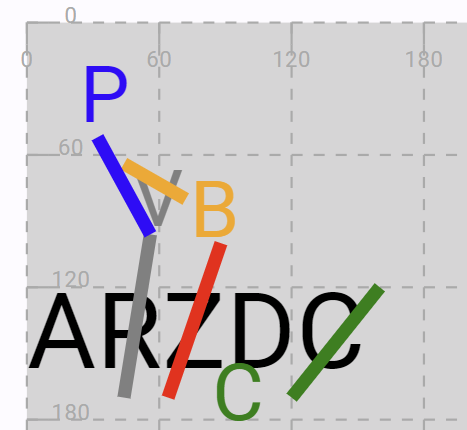

# Snapshot Example

In this example we are going to represent the mock snapshot described in the documentation. Its rendered view is shown below:



The JSON code serializing the underlying model of this snapshot follows, split into various parts so I can add some comments to each one.

## Size and Image

The following snippet specifies the snapshot view size (in pixels) and the optional background image to show as a watermark. You can use this as a reference to create your drawings on top of it, and specify the opacity you want for it.

```json
{
  "size": {
    "width": 800,
    "height": 600
  },
  "image": {
    "url": "https://via.placeholder.com/800x600",
    "opacity": 0.8
  },
}
```

## Text

Them, the base text follows as an array of chain nodes. When you are entering text as a string, the nodes array is automatically built by the editor. In this case I have created it manually to provide a full example.

Each node is an object with a numeric ID, a label, an index, and data which in our case corresponds to a single character (the chain structure is templated for its data type, as we might want to reuse it to chain types different from single characters).

```json
{
      "text": [
    {
      "id": 1,
      "label": "A",
      "index": 0,
      "data": "A"
    },
    {
      "id": 2,
      "label": "R",
      "index": 1,
      "data": "R"
    },
    {
      "id": 3,
      "label": "Z",
      "index": 2,
      "data": "Z"
    },
    {
      "id": 4,
      "label": "D",
      "index": 3,
      "data": "D"
    },
    {
      "id": 5,
      "label": "C",
      "index": 4,
      "data": "C"
    }
  ],
}
```

Optionally you can specify the base text's CSS style (any valid CSS value string) and options (of type `SvgBaseTextOptions`):

```json
{
"textStyle": "font-size: 48px",
  "textOptions": {
    "offset": {
      "x": 0,
      "y": 120
    },
    "lineHeightOffset": 8,
    "charSpacing": 0,
    "spcWidthOffset": 0
  },
}
```

Here we set a big font size, as we just have a few letters; and we offset the base text top-left corner by 0,120 to leave some space for annotations on top of it.

The **base text options** include these properties:

- `lineHeightOffset`\* (`number`): offset to add to each line height.
- `charSpacing`\* (`number`): space to add between characters.
- `spcWidthOffset`\* (`number`): offset to add to the space width.
- `offset` (`Point`): offset for the top-left corner of the base text wrapper rectangle.
- `minLineHeights` (`Record<number, number>`): minimum line heights for each line number (1-N). You can specify a minimum line height for each line number to ensure that its height is at least the specified value. This is useful for making room between lines for annotations that may exceed the base text.

## Operations

[Operations](textual#operations) are objects inside an `operations` array property. They are listed in their order of application. Here I am listing one at a time.

### Delete Z

```txt
3- [*log="delete Z" reason:="don't like Z"]
```

This deletes the character node with ID=3 and injects two context-wide features: a multiple global one (`*log`) and a single node-scoped one (`reason`).

This is because in this example we want to output a sort of per-operation log to keep track of operations execution, and to attach to the deleted `Z` node the reason for its deletion.

The _log_ feature is global and multiple (`setPolicy=0`), which means that whenever it gets added it attaches itself to the result as a whole, rather than to specific node(s); and that there can be many features with the same name. This allows accumulating log features for each operation, thus keeping track of their execution. Here this has only a diagnostic purpose.

The _reason_ feature is not global and thus node-scoped; it it the operation type which determines the nodes it will attach to, corresponding to the affected nodes. Here, the affected node is the `Z` node being deleted. Also, this feature is single (`setPolicy=1`), which means that whenever we add a new feature with the same name, the old one will be removed.

Finally, the diplomatic (visual) representation has a `g` property with the SVG code for the visuals of the operation. In this case, these are just a diagonal red stroke on the `Z` character.

```json
{
  "features": [
  {
    "isGlobal": true,
    "name": "log",
    "value": "delete Z",
    "setPolicy": 0
  },
  {
    "name": "reason",
    "value": "don't like Z",
    "setPolicy": 1
  }
  ],
  "id": "c705f7c65a",
  "type": 1,
  "at": 3,
  "run": 1,
  "diplomatics": {
  "g": "<g id=\"del-z\"><line x1=\"64\" y1=\"170\" x2=\"88\" y2=\"100\" stroke=\"red\" stroke-width=\"6\"/></g>"
  }
},
```

### Replace R with V

```txt
2=V [*log="replace R with V" *version^:=alpha]
```

This replaces `R` with `V`, injecting the usual _log_ feature, and a _version_ feature. The version feature is meant to promote the operation's output to what we consider as a true version of the text. Every operation produces a new step, but not all the steps correspond to versions; rather, they accumulate until one is reached.

For this reason, version is global (attached to the snapshot result as a whole), single (it replaces an existing version feature), and short-lived. The last property means that the feature will be automatically removed as soon as the next operation is executed. This is the desired behavior here, as we tag as "version" a text state, and as soon as we move away from it that's no longer that version.

The operation visuals deserve more comment (see below).

```json
{
  "features": [
  {
    "isGlobal": true,
    "name": "log",
    "value": "replace R with V",
    "setPolicy": 0
  },
  {
    "isGlobal": true,
    "isShortLived": true,
    "name": "version",
    "value": "alpha",
    "setPolicy": 1
  },
  {
    "name": "x",
    "value": "48",
    "setPolicy": 1
  },
  {
    "name": "y",
    "value": "65",
    "setPolicy": 1
  },
  {
    "name": "style",
    "value": "font-size:36px;fill:gray",
    "setPolicy": 1
  }
  ],
  "sources": [],
  "id": "66aed192fc",
  "type": 0,
  "at": 2,
  "run": 1,
  "value": "V",
  "diplomatics": {
  "g": "<g id=\"rep-RV\"><line x1=\"44\" y1=\"170\" x2=\"56\" y2=\"96\" stroke=\"gray\" stroke-width=\"6\"/></g>"
  }
},
```

The operation visuals here are distributed in two different layers of the snapshot: one is the base text, because we are adding a new node, `V`; another is the diplomatic layer, where we add any visuals representing the operation.

The new node we add should be outside the automatic layout of the base text. This just displays each character after another in a line; but here we want to represent the added character just like it appears in the snapshot, above the text and at the edge of a stroke on the replaced character.

We do not want to represent this `V` character as a mere visual on the diplomatic layer, because it is part of the text: it's a node in it. Yet we have to remove this node from the automatic layout and place it where it belongs. This will allow it to be treated as all the other text nodes in the snapshot.

To this end, we add some node-scoped features to the operation, which will be thus injected in `V`: _x_, _y_, and _style_. A node having _x_ and _y_ is placed at these coordinates, thus outside the automatic layout. Also, the style specifies its color (gray) and its size (a bit smaller than the base text).

💡 Features names _style_ and _class_ are reserved to represent the SVG element attributes `style` and `class` respectively.
