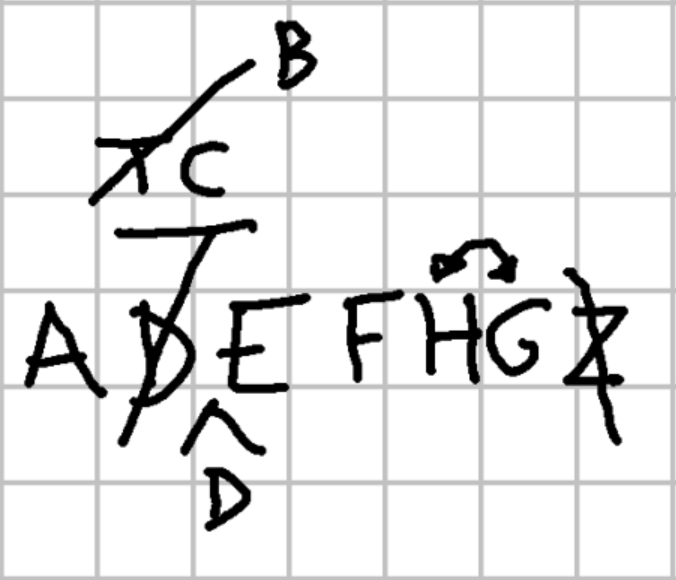

# Text Model

Base text: free selection, YXAR. This locates a layer fragment.

TODO: refactor

Each fragment is a `VarFragment`:

- `location` (string)
- `ordinals` (dictionary with key=version tag, value=int)
- `root` (`VarNode[]`): the root node of text variants for this fragment.
  - *️⃣ variant:
  - `at` (`short`)
  - `run` (`short`)
  - `operation`: one of `rep`, `del`, `adl`, `adr`, `ann`, `mov`, `swp`.
  - `arguments` (`VarOpArgument[]`):
    - `name` (omitted if positional)
    - `value`
    - `rank` (`short`)
    - `note`
  - `note`
  - `groupId`
  - `versionTags` (`string[]`)
  - *️⃣ diplomatic:
  - `diplomatic` (`VarDiplomatic`):
    - `position` (`TextPosition`):
      - `textAnchor`
      - `dominantBaseline`
      - `transforms` (`string[]`)
    - `features` (`FeatureSet[]`):
      - `id`
      - `type` (set type, e.g. style, class, shape)
      - `features` (dictionary of `TaggedValue`; so each feature it's a name=value pair):
        - `value`
        - `versionTags` (`string[]`)
  - *️⃣ sources:
  - `sources` (`VarSource[]`):
    - `id`
    - `type`
    - `rank`
    - `note`
  - *️⃣ tree:
  - `children` (`VarNode[]`)

Operations:

- `at`, `run` referring to the last output.
- types:
  - `rep` (replace): `value`.
  - `del` (delete).
  - `adl` (add-left): `value`.
  - `adr` (add-right): `value`.
  - `ann` (annotation): `value`.
  - `mov` (move): `at`, `run`.
  - `swp` (swap): `at1`, `run1`, `at2`, `run2`.

Generating variants:

1. collect all the distinct variant tags.
2. for each variant tag:
   1. for each fragment:
      1. walk from its root and collect outputs after each operation tagged for the current variant. In case of groups, drop the outputs of the operations of the same group except the last.

## Example

Say you have this script:



The final version of this text is:

```txt
ABCDEFGH
```

Yet, the author created it in a series of different operations.

The "original" written text (here named _base text_) is the one written in the layout considered as canonical for the support. In our case, we just write on a sheet following the lines. This is the text `ADEFHGZ`, on top of the same, unique line.

After this, there were changes on the base text. Apart from trivial cases, it would be difficult or impossible to define their order: here our sheet just presents the final state of the support, after all the changes have been made. So, we just adopt a model which conventionally describes the operations following the writing order, here from left to right. We track relative time only starting from each operation stemming from the base text.

For instance, consider `D`: the base `D` here is replaced by `TC` (1). This is the first node in the layer of operations editing the base text. Then, in turn `T` in `TC` is replaced by `B` (2). This is another node, stemming from the one related to operation 1. This hierarchy reflects the relative time of these two operations: first 1, then 2.

If you then consider other operations on the base text, we have:

(3) the insertion of D before E;
(4) the swapping of H with G;
(5) the deletion of Z.

Now, we could not say whether (4) effectively happened before or after (5). So, while in most cases we cannot be sure of the relative order of operations stemming from the base, in most cases we can be sure of those stemming from them: their descendant nodes.

Thus, as a default behavior we just follow a left-to-right order in describing the operations; but this has no implication about the effective chronological sequence of them; it's just a convention adopted for their linear description. At any rate, you can assign a relative order to operations by setting their number.

Having said that, let us consider the operations. Each span of text selected from the base text for an operation, whose extent is free, represents the starting text for it. Once this span has been selected for a base operation type, the first operation works on it as a string; the second operation works on the result of the first one, as a string; and so forth.

>Base operations type are `rep`, `del`, `adl`, `adr`, `ann`; they exclude `mov` and `swp` because the range of any of their arguments might fall outside the selected span's text.

(1) selection: `D`, base operation `rep` (replace). Operation nodes:

- 1.0. base: `rep` on `D`.
- 1.1. `rep@1x1:'TC'`: replace a single character at 1 (AR coordinates: at, run: `D`) with `TC`. Result: `TC`.
- 1.2. `rep@1x1:'B'`: replace `T` with `B`. Result: `BC`.

The effect on the base text is that `D` is replaced by `TC` in a hypothetic version, and by `BC` in another one, thus producing:

- `ATCEFHGZ` (1.1)
- `ABCEFHGZ` (1.2)

Now, of course it might have happened that the author replaced D with TC, maybe for just a typo; and immediately after, he corrected T into B. So, effectively, the version `ATCEFHGZ` would never have been existed, at least as a conscious intention of the author. But at this descriptive level, we are not concerned with this interpretation; we just want to represent the operations we can infer from our written sheet of paper. Interpretation will be encoded by further attributes of the model, as we will see later.

(2) selection `E`, base operation `ins` (insert). This isn't the only way of representing the variant. Another, perhaps even better way of representing it would be treating the insertion of `D` as just another operation stemming from the node attached to `D`; because this text is replaced with something else, and then re-appended after these replacements. So, if we rather wanted to represent it this way, we could just add it as the third node in our list of (1): 1.3. `adr@2:'D'`. Anyway, here to keep things simple we just represent a base operation for each operation graphically attached to the base text.

- 2.0. base: `adl` on `E`.
- 2.1. `adl@1:'D'`: add `D` to the left of `E`. Result: `DE`.

The effect on the base text is:

- `ABCDEFHGZ` (2.1)

(3) selection `H`, base operation `rep` (replace). Note that swap or move operations are not allowed as base; so we rather represent the effect of swapping `H` with `G` as two replacements. We can use a group ID to group these two operations together into what at a higher level of interpretation can be viewed as a swap.

3.0. base: `rep` on `H`.
3.1. `rep@1x1:'G'`. Result: `G`.

The effect on the base text is:

- `ABCDEFGGZ` (3.1, partial). This is considered as partial because this replacement belongs to a group, and not all the operations belonging to this group have been executed yet.

(4) selection `G`, base operation `rep` (replace):

4.0. base: `rep` on `G`.
4.1. `rep@1x1:'H'`. Result: `H`.

The effect on the base text is:

- `ABCDEFGHZ`

(5) selection `Z`, base operation `del` (delete):

5.0. base: `del` on `Z`.

The effect on the base text is:

- `ABCDEFGH`

So in the end, these are the final computations after each operations subtree:

- `ATCEFHGZ` (1.1)
- `ABCEFHGZ` (1.2)
- `ABCDEFHGZ` (2.1)
- `ABCDEFGHZ` (4.1)
- `ABCDEFGH` (5.1)
