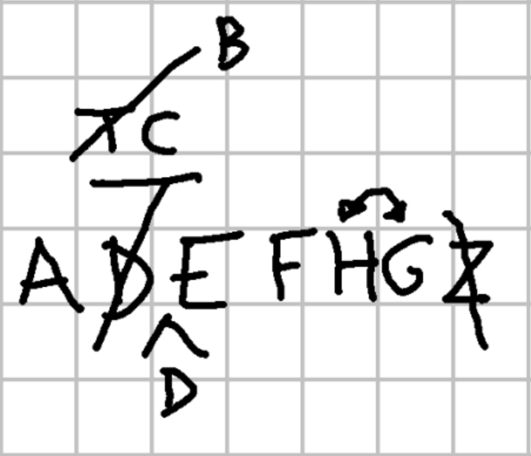

# Variant Generation Operations

In GVE there are 5 types of operations to generate text variants:

(a) text:

- replace: `ATxRUN="VALUE"^RANK@GROUP [TAG...] {NOTE}`
- add left: `AT+<"VALUE"^RANK@GROUP#TAG,TAG {NOTE}`
- add right: `AT+>"VALUE"^RANK@GROUP#TAG,TAG {NOTE}`

(b) movements:

- move: `ATxRUN>ATxRUN^RANK@GROUP [TAG...]  {NOTE}`
- swap: `ATxRUN<>ATxRUN^RANK@GROUP [TAG...]  {NOTE}`

(c) annotations:

- annotate: `ATxRUN:NAME="VALUE" [TAG...] {NOTE}`

All the operations except `annotate` change the text value. The components of their syntax are:

- `AT`: the ordinal number of a character (1-N).
- `RUN`: the number of characters to take from `AT`.
- `VALUE`: the primary argument, corresponding to a string representing text or other values.
- `RANK`: a rank representing the certainty level: 0=not specified, 1=most probable, 2=less probable, etc.
- `GROUP`: an arbitrary string defined to group many operations into a single virtual operation.
- `TAG`: a version tag. Multiple version tags are separated by space.
- `NOTE`: an optional note to add to the output annotations.
- `NAME`: the name of an annotation metadatum.

For instance, consider this example:

Here we could describe the text variants with the following tree ofoperations, starting from the base text `ADEFHGZ`:

- ✏️ `2="TC"`: replace `D` with `TC`:
  - input:  `ADEFHGZ`
  - output: `ATCEFGHZ`
  - ✏️ `1="B"`: replace `T` with `B`:
    - input:  `TC`
    - output: `BC`
- ✏️ `2`
